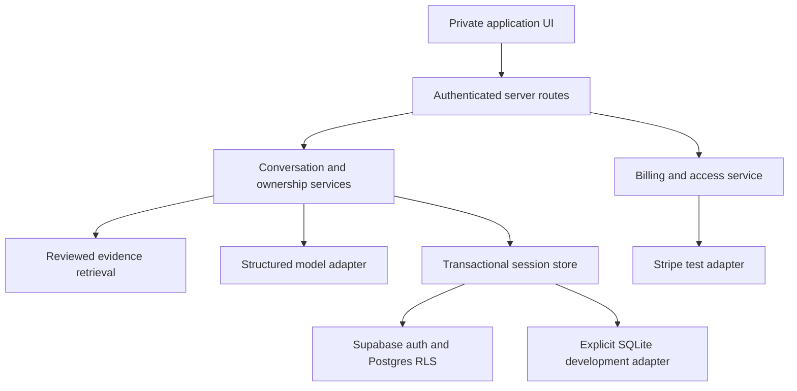
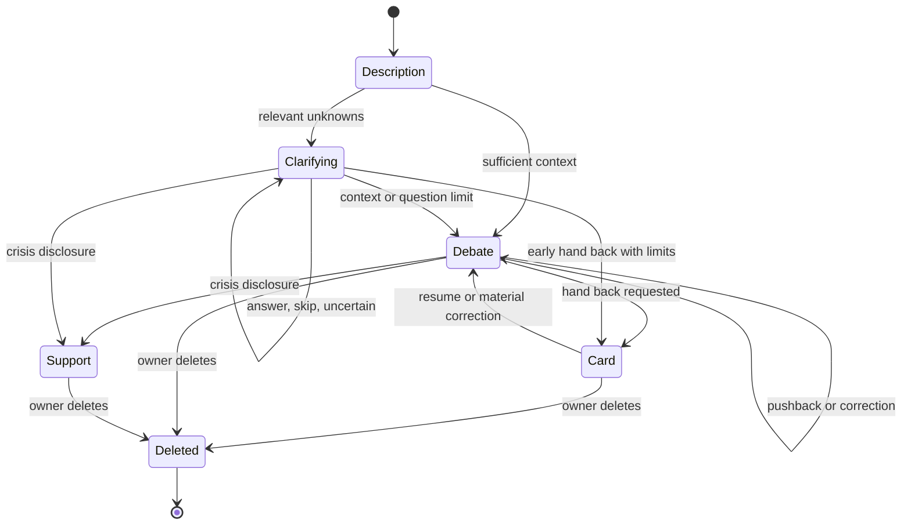
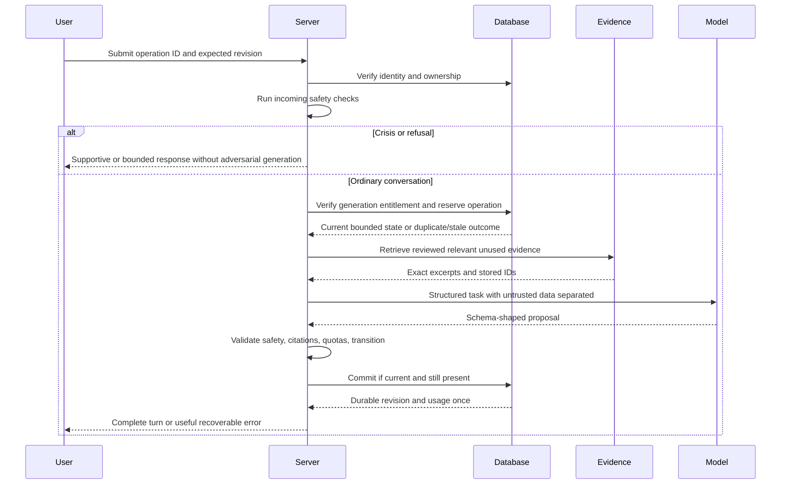
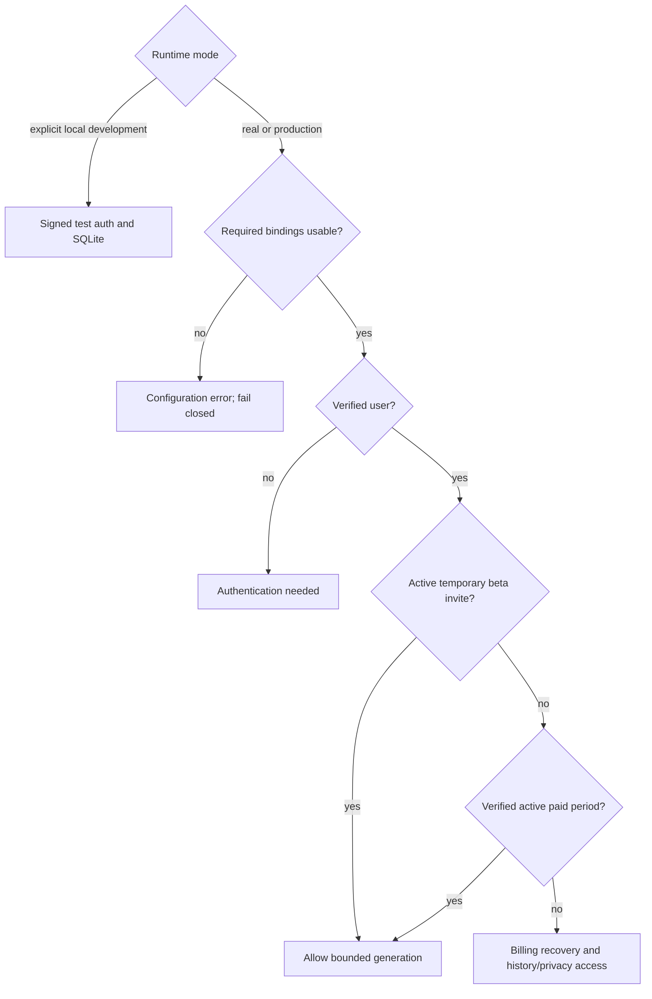
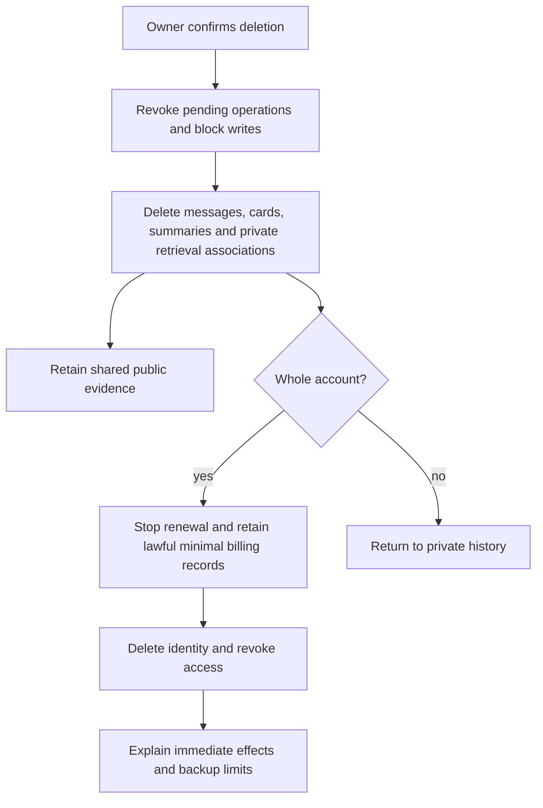

# Devils Advocate Application - Plan

## Goal Capsule

- **Objective:** Users can stress-test an idea or decision through a private, resumable conversation that presents both sides with inspected evidence and ends with a useful card and a practical first step.
- **Means:** A Next.js application with Supabase, a server model adapter, and Stripe test billing (KTD1–KTD8).
- **Authority:** User instructions and the source brief govern product behavior. Product requirements govern technical decisions; implementation units may refine file organization without weakening those requirements.
- **Execution profile:** Build the complete conversation vertical slice first, then billing and operational hardening. Continue independent work when external credentials are missing and label deterministic adapters accurately (R24).
- **Stop conditions:** No production deployment, PR merge, live charges, production data changes, secret disclosure, fabricated evidence, or recreation of an absent marketing site. Missing credentials block live checks, not independent implementation.
- **Tail ownership:** Delivery includes a reviewable branch and open PR, test evidence, startup and deployment documentation, and explicit unverified integration prerequisites. If GitHub API access remains blocked, preserve the completed branch and report the precise PR creation blocker.

---

## Product Contract

### Summary

Build a text-only application for challenging business ideas and personal decisions. Deliver a private conversation, inspectable citations, saved history, hand-back cards, invite-only beta access, and subscription billing in test mode.

### Problem Frame

Users need thoughtful resistance to their assumptions without a chatbot inventing sources or deciding for them. The product serves MBA students, first-time founders, young professionals in India, and founders and professionals internationally.

The inspected repository contains only the initialization README at main commit `4b3dd9c`. The Astro marketing site, six scripted demos, design files, and waitlist described in the brief are absent. Their preservation cannot be verified in this checkout.

### Requirements

**Conversation and cards**

- R1. Provide explicit mint Business validation / Challenge my idea and lavender Philosophy / Challenge my decision modes, with Business validation selected by default.
- R2. Business conversations examine customers, payer, willingness to pay, serving costs, distribution, competition, seasonality, and assumptions, using comparable documented struggles with relevant differences.
- R3. Philosophy conversations examine the underlying question, values, obligations, reversibility, risks, and circumstances, with actual texts and specific edition-aware references on both sides.
- R4. Ask no more than three adaptive clarification questions before arguing, asking fewer when sufficient context exists and accepting skip, uncertainty, clarification, and corrections without repeating answered questions.
- R5. Show the underlying question and genuine strengths before the opposing case; support multiple free-text pushback rounds with new evidence or materially different reasoning when available.
- R6. Explain exhausted or missing evidence honestly and distinguish sourced facts, interpretations, paraphrases, and experiments without final verdicts, win probabilities, confidence scores, or instructions to proceed or abandon.
- R7. Generate a versioned hand-back card on demand or completion containing the one-line position, strengths, up to three supported counterpoints with sources, open personal questions, a cheap experiment or reversible step this month, and “Your call. Always.”
- R8. Store cards with their session revision, update them after material corrections, and support history access, copying, and simple downloads without padding unsupported counterpoints.

**Evidence and model correctness**

- R9. Retrieve only from stored, reviewed evidence; validate every citation against retrieved evidence IDs server-side and display direct quotes only when they exactly match inspected stored excerpts.
- R10. Store business identity, attempted business, customer/industry/geography/period where known, documented outcome, reported causes, supporting excerpts, source metadata, supported-versus-interpretation status, and verification/review metadata.
- R11. Store philosophical author, work, translation/edition, book/chapter/section/page where applicable, exact excerpt, source identifier, quote/paraphrase status, verification/review metadata, and licensing constraints without invented page numbers.
- R12. Provide an inspected small seed collection and a repeatable ingestion/review workflow with documented coverage limits; fictional demo startups never become production evidence and an accessible URL alone never proves support.
- R13. Keep model calls server-side and validate structured session state, clarifications, question, strengths, counterpoints with evidence IDs, open questions, tests, and cards through schemas.
- R14. Bound timeouts, transient retries, token/cost budgets, cancellation, and concurrent requests; duplicates, provider failures, and partial output must not corrupt saved state or count usage twice.
- R15. Treat retrieved text as untrusted data and track used arguments/evidence to reduce repetition, with a provider adapter that can change independently of the application.

**Ownership and privacy**

- R16. Implement supported authentication, sign-out, session creation/history/resume/rename, individual deletion, and account deletion with clearly defined effects.
- R17. Enforce ownership on every server operation and through database row-level policies; public browser credentials never carry privileged service-role access.
- R18. Treat conversations as sensitive, exclude their bodies and secrets from default logs, and document model egress, provider retention uncertainty, access-controlled storage versus end-to-end encryption, deletion cascades, backups, and billing retention.

**Access and billing**

- R19. Use invite-only beta with explicit, temporary free access that expires without automatically starting billing; launch date December 1, 2026 is configurable and scheduled availability is distinct from actual availability.
- R20. Offer $59 USD monthly and $150 USD yearly subscriptions, displaying $12.50 yearly monthly equivalent and $558 / approximately 79% savings accurately, with both modes and all four topic areas included.
- R21. Use Stripe test checkout and billing portal, verified webhook signatures, idempotent processing, subscription synchronization, cancellation, and failed-payment handling; enforce entitlement server-side and never trust a redirect or client status.
- R22. Publish reasonable fair-use rate/concurrency controls honestly beside unlimited-debate messaging and protect usage counting from duplicate requests without hiding a small fixed allowance.

**Safety, UI, and delivery**

- R23. Stop adversarial discussion for crisis/self-harm and harmful escalation, respond supportively without humor, and direct users toward appropriate human assistance without guessing emergency numbers; refuse political debates and bound medical, legal, financial, and sensitive advice plainly.
- R24. Run deterministic, explicitly labeled local adapters when credentials are unavailable, preserve durable ownership and session semantics, and fail closed in configured real mode instead of silently falling back.
- R25. Cover entry/authentication, home, conversation, accessible source detail, cards, history, account/privacy, and billing with empty/loading/error/offline/unauthorized states.
- R26. Use the brief's light-grey/white semantic tokens, one accent per session, right user bubbles, left product bubbles, yellow citations, dark mode, approximately 17px text, restrained shadows, rounded controls, visible focus, 44px targets, AA contrast, 360px responsiveness, and reduced motion.
- R27. Preserve any supplied marketing site and waitlist without converting signup to authentication or payment; document the separate marketing/app boundary and the unavailable preservation check.
- R28. Provide pinned dependencies, repeatable local commands, placeholder environment configuration, versioned migrations, health checks, structured redacted logs, reproducible tests without production services, deployment guidance, cost controls, and a separate model evaluation set.
- R29. Verify the brief's 22 acceptance behaviors, distinguish deterministic tests, real-browser tests, model evaluations, sandbox integrations, and live checks, and report blockers without claiming production readiness.

### Key Decisions

- **Private beta with temporary free access** is carried forward as the accepted default over open public access and immediate billing. Governs R19, R21.
- **Keep the user's decision theirs** follows the source product promise. Governs R5–R8, R23.

### Actors and Key Flows

- A1. Invited user owns their sessions, answers or skips clarifications, challenges assumptions, manages history and billing, and deletes private data.
- A2. Application server checks access, retrieves inspected evidence, validates model output, and commits consistent revisions.
- A3. Supabase authenticates and stores ownership-protected records; Stripe supplies authenticated billing state; the model provider sees only bounded permitted context.
- A4. Evidence reviewer inspects original source material and imports immutable reviewed records outside the public UI.
- F1. Authenticate → confirm access → choose mode/topic → describe position → clarify → strengths then counterarguments → push back → hand-back card → history/resume. Covers R1–R18, R19, R24–R26.
- F2. Billing page → test checkout → signed webhook → canonical subscription synchronization → server entitlement → billing portal/cancel. Covers R19–R22.
- F3. Account privacy view → explicit session/account deletion confirmation → reject or cancel ongoing writes → remove private derived records → revoke access and describe retained billing/backups. Covers R16–R18.

### Acceptance Examples

- AE1. Covers F1 / R4–R9. A founder describes a college food-delivery proposal, skips one relevant clarification, and corrects who pays; strengths precede counterarguments and the card reflects the correction with only supported citations.
- AE2. Covers R3, R6, R9, R11. A personal decision has no relevant stored source; the app labels reasoning and coverage limits instead of adding a quote or invented page number.
- AE3. Covers R14, R16–R18. Two requests use the same turn ID and stale revision; one consistent result persists, then deletion prevents an in-flight result from recreating the session.
- AE4. Covers R19–R22. An expired beta user returning from a checkout URL gains no paid access until Stripe supplies a verified active subscription; duplicate or older webhook deliveries cannot revert newer canonical state.
- AE5. Covers R17. User B cannot list, read, rename, generate a turn/card for, or delete user A's session through UI, direct endpoints, or database access.
- AE6. Covers R23. A self-harm disclosure during pushback immediately switches to supportive guidance with no adversarial argument or joke.

### Scope Boundaries

The application is the deliverable in this repository. The marketing brief's static-site restrictions do not prohibit the application's backend/authentication/payments.

#### Deferred to Follow-Up Work

- Locate the separate marketing source and verify its animations, mode switching, six scripted demos, pricing, FAQ/privacy, and waitlist insert-only access, consent, validation, case-insensitive uniqueness, duplicate handling, and confirmations (R27).
- Production deployment and live service validation remain operator tasks after sandbox configuration and review (R24, R29).

#### Outside This Product's Identity

No public session sharing, feeds, teams, voice, avatars, gamification, unrelated dashboards, political entertainment, final verdicts, fake testimonials, fabricated user counts/logos, decorative emoji, gradients, or stock illustrations.

---

## Planning Contract

### Assumptions

- Mode stays immutable within a session; changing modes starts a new session.

These are explicit defaults, not additional user-approved product decisions.

- The missing marketing site lives elsewhere. This app uses the brief's written design language; no existing tokens or components can be copied or attested preserved.
- The four topic areas are startup ideas, work/side projects, major life decisions, and personal beliefs, matching the stated product scope.
- Invites are provisioned by an operator, with individually explicit expiry timestamps. Beta activation is configurable and never inferred from the launch date alone.
- Local preview is a development tool with a persistent SQLite database and signed test-only accounts. Production deployment must reject local adapters, including test auth and file-backed storage.
- OpenAI structured outputs are the initial real-provider target only if current SDK/source inspection supports the selected model/API; exact supported model and retention settings remain configuration, not marketing promises.
- Fair use starts with one active generation per user, 10 submissions per minute, bounded input/history, and an operator daily spend circuit breaker. These are disclosed throttles, not a fixed debate allowance; final numeric limits may change only with matching UI/documentation.
- A single Node application deployment on a supported managed Node host is the documented default. Real persistence is Supabase, so deployment does not depend on writable local files.

### Key Technical Decisions

- KTD1. **One Next.js TypeScript application at the repository root.** Use App Router UI plus server route handlers and shared typed domain services. No Astro package exists to preserve; the structure avoids an unnecessary monorepo while keeping a future separate marketing host possible. Advances R25–R28.
- KTD2. **Explicit dependency-injected service boundaries.** Authentication, session store, model generation, billing, evidence retrieval, and clock expose shared async contracts. Deterministic adapters are selected only by explicit development configuration, visibly labeled, and forbidden in production. Advances R13–R18, R24.
- KTD3. **Supabase supported SSR authentication and Postgres RLS.** Validate sensitive server operations with `getUser()` rather than accepting a decoded cookie or unexpired revoked JWT alone, use secure session cookies, and keep privileged user/invite administration server-only. Disable public registration and request invite-only magic links with `shouldCreateUser: false`. Await Next.js 16 cookie/parameter APIs; Supabase SSR `getAll/setAll` must preserve refreshed cookies and cache headers across redirects. Every session child inherits an owner constraint and cascade lifecycle; real-service integration tests must prove policies independently of application ownership tests. Advances R16–R18.
- KTD4. **Transactional revisions and idempotent operations.** Persist owner-scoped sessions, messages, turn operations, usage events, and card versions; use expected revision checks and unique owner/operation IDs and a request fingerprint that rejects reuse with different input. Reserve a turn atomically, call the provider outside the transaction, then commit validated results only if the operation remains current and the session exists. Deletion/account closure revokes pending operations, so late completion cannot recreate content. Persist pending/failed/cancelled operation state with expiring leases; interrupted reservations can be recovered on resume without counting success or duplicating a user message. SQLite development and Postgres RPC/database transactions implement the same invariants. Advances R8, R14, R16–R18.
- KTD5. **Reviewed exact excerpts and bounded lexical retrieval first.** Import source snapshots and metadata only after human/source inspection, hash the excerpt/version, rank by mode/topic/relevance, and pass only relevant reviewed records. The server supplies citation labels/URLs from records and verifies IDs, excerpt equality, and quote/paraphrase status. Quote equality alone is insufficient: reviewed claim/excerpt support metadata and semantic relevance must also constrain counterpoints, including paraphrases. Embeddings and live web search are unnecessary for the initial small corpus. Advances R9–R12, R15.
- KTD6. **One bounded structured generation pipeline.** Understanding/clarification, retrieval, argument, citation checks, and card shaping remain separate functions in one server orchestration, not autonomous product agents. Schema validation rejects unsupported citations, arbitrary URLs, fabricated quotes, excess questions, and invalid state transitions before persistence. Untrusted source excerpts never become system instructions; the model has no billing, deletion, or account tools. Advances R4–R15, R23.
- KTD7. **Non-streaming atomic turns for the first release.** Show a pending response and cancellation, then publish only a fully validated committed turn. Retry only transient provider errors within two attempts and a request deadline; schema/citation failures remain useful errors or explicit no-evidence output, never silently accepted content. Store provider token metadata without conversation bodies and count committed logical operations once. Separately reserve/reconcile provider spend per attempt, including retries, invalid output and cancellation; conservatively account for attempts whose billed outcome is unknown so repeated failure cannot bypass the daily circuit breaker. Advances R14, R18, R22.
- KTD8. **Stripe test subscriptions synchronized from canonical provider state.** Reject live secret keys and live webhook events. Authenticate checkout/portal, select server-owned price IDs, verify the raw webhook payload, and durably record event IDs plus retryable processing state. Retrieve current subscription state for relevant events rather than sorting arrival order, with atomic entitlement updates. Paid access requires permitted active status and current paid period; beta expiry is a separate entitlement path. Cancellation retains access until the current paid period ends; failed/past-due payments show recovery with no new paid generation. A turn reserved while entitled may finish within its original deadline after entitlement expiry; subsequent turns require renewed access. History, export, deletion, and safety support remain accessible after generation entitlement expires. Advances R19–R22.
- KTD9. **Privacy and safety at the service boundary.** All session responses are private/no-store, mutations check same-origin CSRF protections, untrusted messages render as text, and redirects/citation URLs allow only expected safe destinations. Crisis/refusal checks run before ordinary adversarial generation; use layered rules plus structured classification, tested with paraphrases, and document the limits of automated classification. Advances R17, R18, R23, R26.
- KTD10. **Separate evidence, model, and integration assurance.** Deterministic state/permission/billing/citation tests prove contracts, real Chromium tests prove UI flows, and a held-out evaluation set probes generated quality. Credential-gated Supabase, Stripe sandbox, and model runs are reported unverified until exercised. Advances R12, R24, R28, R29.

### High-Level Technical Design

Component boundaries (KTD1–KTD6):



Conversation state and revision lifecycle (R4–R8, KTD4, KTD7):



Turn protocol and data flow (KTD4–KTD7):



Access decision and adapter modes (R19–R24, KTD2, KTD8):



Deletion lifecycle (R16–R18, KTD4):



### Schema and Output Structure

Core relations: user profiles; beta invites/expiry; sessions with owner/mode/topic/revision; messages and operation records; card versions; usage/limits; reviewed evidence and excerpt versions; billing customers/subscriptions; webhook processing records; account-deletion state. Public evidence is shared read-only, with admin-only ingestion. Private children reference session ownership and cascade deletion. Operational records must not retain conversation text.

Expected layout:

```text
src/
  app/                  UI pages and authenticated route handlers
  components/           Accessible conversation, cards, source detail and controls
  lib/
    contracts.ts        Validated domain shapes and adapter contracts
    config.ts           Runtime bindings and mode validation
    auth/               Supabase and explicit local authentication
    store/              Supabase and persistent local adapters
    evidence/           Review, retrieval and citation validation
    model/              Structured real-provider and deterministic adapters
    conversation/       State transitions, safety and orchestration
    billing/            Stripe and deterministic sandbox adapter
    privacy/            Deletion lifecycle
  styles/               Semantic tokens and responsive themes
supabase/migrations/    Versioned schema, policies and transactional functions
data/evidence/          Reviewed public excerpts and source metadata
scripts/                Evidence import and local/integration validation helpers
tests/                  Unit, integration, evaluation and real-browser coverage
docs/                   Source brief, plan, operations, privacy and test reports
```

### Dependencies, Operations, and Risks

Registry inspection supplied supported candidate pins: Node 24.19.0, Next.js 16.4.0, React 19.3.0, TypeScript 7.0.2, Supabase SSR 0.12.7 / JS 2.117.3, Stripe 23.0.0, Zod 4.6.7, Vitest 5.0.4, and Playwright 1.64.0. The implementer must choose mutually compatible exact versions and commit the lockfile; registry existence is not proof of compatible APIs. Use the installed Chromium for browser evidence.

No application credentials are configured. `.env.example` will name Supabase URL/public key, server administration credential only where required, model key/model identifier, Stripe test secret/webhook secret/monthly and yearly price IDs, canonical app origin, explicit runtime mode, development signing key/storage path, beta activation/launch date, and cost/rate settings. Secret values belong in environment settings, never chat or committed files.

Required real destinations include the configured Supabase project, model API, Stripe API, and documentation/source hosts. GitHub API egress currently returns proxy CONNECT 403; the configuration now lists `api.github.com`, but runtime proxy access still fails and must be rechecked after an effective network change. Native Git access works, so a completed branch remains deliverable if PR creation is blocked.

Operational costs come from managed hosting/database tiers and model token usage, plus payment-provider fees when billing eventually goes live. Document actual current quoted pricing only after inspection; provide the estimate formula of requests × input/output tokens × configured per-token prices and enforce an operator spend ceiling rather than inventing a monthly bill.

Main risks are citation relevance, unsafe generated advice, tenant isolation, cross-request consistency, and billing drift. KTD3–KTD10 bind mitigations and tests. A small corpus has narrow coverage and cannot substantiate arbitrary ideas; retrieval must prefer honest gaps over weak citations. Crisis classification is imperfect and must not be advertised as a guarantee.

### Sources and Research

Official repository sources inspected for integration guidance: [Next.js 16 migration guide](https://raw.githubusercontent.com/vercel/next.js/canary/docs/01-app/02-guides/upgrading/version-16.mdx), [Supabase SSR](https://raw.githubusercontent.com/supabase/ssr/main/src/createServerClient.ts), [Supabase RLS](https://raw.githubusercontent.com/supabase/supabase/master/apps/docs/content/guides/database/postgres/row-level-security.mdx), [Stripe SDK](https://raw.githubusercontent.com/stripe/stripe-node/master/README.md), and [OpenAI structured-output helpers](https://raw.githubusercontent.com/openai/openai-node/master/src/helpers/zod.ts). These shape KTD3, KTD4, KTD8 and KTD10. Next.js 16 needs awaited request APIs and separate ESLint; Stripe 23 uses API version `2026-09-30.endive`, which must match the configured webhook endpoint. The official documentation sites and broad sunset search were unavailable through the proxy; check installed SDK declarations before adopting moving-main examples.

Inspected seed research includes the official RethinkDB shutdown announcement at pinned commit `1be3fee3b171bbdba45e013001f9780b555c67bd`, Mill's On Liberty chapters II/III and Utilitarianism chapter II, and Aurelius' Meditations in Casaubon's translation. RethinkDB supports unsustainable-business/shutdown claims only, not invented pricing/customer explanations. Startup coverage is developer infrastructure, not Indian consumer delivery or arbitrary CRM cases; unrelated prompts must get sparse/no evidence. Edition-specific sections and licensing travel with every philosophy record. Optional Atom retirement material is a product retirement, not a fictional failed startup. Governs U3 through R9–R12.

### Deferred Configuration Questions

These do not block deterministic implementation: actual Supabase project and auth redirect/SMTP configuration; operator invite/expiry provisioning; selected supported model and provider retention controls; Stripe test prices and webhook destination; deployment domain; marketing repository/location; and GitHub API egress for PR creation. Each gates its own integration/rollout evidence.

### Alternative Approaches Considered

Astro-only would suit the described static marketing pages but introduces friction for private dynamic sessions and protected APIs. A monorepo would be useful if the marketing package existed; the inspected root has no such package. Next.js keeps the first application deployable as one server while separating domain services from framework code.

Live web retrieval and embeddings would broaden coverage but add verification, licensing, prompt-injection, and cost concerns before basic citation integrity is proven. Reviewed local excerpts with lexical retrieval make the initial limits auditable (KTD5).

Runtime multi-agent debates would add independent failure and cost paths. A single typed orchestration preserves consistent saved revisions and permits provider replacement (KTD6).

---

## Implementation Units

### U1. Reproducible application and domain contracts

**Goal:** Establish one installable typed application and shared domain boundaries.

**Requirements:** R1, R7–R15, R24–R28; KTD1, KTD2.

**Dependencies:** None.

**Files:** `package.json`, `package-lock.json`, `.gitignore`, `.env.example`, `tsconfig.json`, `next.config.ts`, `vitest.config.ts`, `playwright.config.ts`, `src/lib/contracts.ts`, `src/lib/config.ts`, `src/styles/tokens.css`, `src/app/layout.tsx`, `tests/config.test.ts`, `README.md`.

**Approach:** U1 alone owns dependency installation and the package lockfile. Pin compatible dependencies, define validated request/state/evidence/card shapes and async service contracts, and establish explicit runtime mode and secret boundaries. Carry missing marketing as the documented assumption. A theme toggle and tokens should support R26 without a UI library requirement.

**Patterns to follow:** The initial README's existing isolated checkout rule; KTD1, KTD2.

**Test scenarios:**

- Missing required real-mode bindings produce a useful setup error without revealing values.
- Explicit local mode works without external credentials, while production refuses that mode.
- Public configuration excludes model, Stripe, service-role, and development signing secrets.

**Verification:** Frozen installation, static typing, and application build succeed with a documented supported toolchain.

### U2. Authentication, durable ownership, and access foundations

**Goal:** Persist private sessions with supported real authentication and faithful local development behavior.

**Requirements:** R8, R14, R16–R19, R24; F1, F3, AE3, AE5; KTD2–KTD4.

**Dependencies:** U1.

**Files:** `src/lib/auth/service.ts`, `src/lib/auth/supabase.ts`, `src/lib/auth/local.ts`, `src/lib/store/service.ts`, `src/lib/store/supabase.ts`, `src/lib/store/local.ts`, `supabase/migrations/001_application.sql`, `src/app/api/auth/route.ts`, `src/app/auth/callback/route.ts`, `src/app/api/sessions/route.ts`, `src/app/api/sessions/[id]/route.ts`, `tests/auth-store.test.ts`, `tests/supabase.integration.test.ts`.

**Approach:** Implement the contracts from U1 and ownership predicates at every operation. Version the Postgres schema/policies/transactional functions, persistent SQLite adapter, secure local development sessions, and supported Supabase cookie/redirect flow. Session operations must carry expected revisions and operation identity per KTD4.

**Execution note:** Prove cross-user denial and transactional duplicates before connecting model generation.

**Patterns to follow:** KTD3, KTD4 and inspected official Supabase SSR guidance.

**Test scenarios:**

- Covers AE5. Two identities create sessions; direct list/read/update/delete operations never return or modify the other identity's session.
- Sign-out and expired/tampered development cookies revoke access; callbacks reject unsafe external redirects.
- Rename and history survive adapter restart, including mode and current revision.
- Concurrent duplicate reservations return one result; stale revisions return a recoverable conflict.
- Supabase policy tests use two real sandbox users and direct table access; mark unrun when credentials/service are absent.
- Where local Postgres is available, apply migrations with minimal auth schema/JWT role stubs and exercise anonymous/owner/other-owner SQL/RPC access; report this SQL evidence separately from actual Supabase auth integration.

**Verification:** Durable local ownership tests pass; migrations and real adapter are reviewable, with Supabase claims separately verified only when its integration target runs.

### U3. Inspected evidence collection and citation enforcement

**Goal:** Supply real inspectable sources and reject decorative or fabricated citations.

**Requirements:** R2, R3, R6, R9–R12, R15; AE2; KTD5.

**Dependencies:** U1.

**Files:** `data/evidence/seed.json`, `src/lib/evidence/schema.ts`, `src/lib/evidence/retrieve.ts`, `src/lib/evidence/validate.ts`, `scripts/evidence-import.ts`, `docs/evidence.md`, `tests/evidence.test.ts`.

**Approach:** Import a small actually inspected corpus with exact excerpts and immutable source/review metadata. Prefer authoritative primary business records and licensed/public-domain philosophy texts. Mark source access failures as unverified and exclude those records from retrieval. Document coverage limits and a draft → inspected → reviewed process without an admin dashboard.

**Patterns to follow:** KTD5; source-specific licensing/edition information.

**Test scenarios:**

- A relevant topic retrieves reviewed records in the matching mode; unrelated and unverified records are excluded.
- An unknown or unretrieved citation ID, fabricated URL, altered quote, invented page, or unsupported quote label is rejected.
- A verified paraphrase renders a paraphrase label and source reference, while exact excerpts render as quotes.
- Covers AE2. Empty retrieval yields no citations and an explicit coverage limitation.
- Retrieved text containing instructions cannot alter orchestration authority or add model tools.

**Verification:** Each seed excerpt is traceable to an inspected original and retrieval/validation tests pass; inaccessible material is never called verified.

### U4. Conversation engine, model adapter, and hand-back state

**Goal:** Deliver coherent conversation transitions with validated evidence and atomic resumable state.

**Requirements:** R1–R8, R13–R15, R22, R23; F1, AE1–AE3, AE6; KTD4–KTD7, KTD9.

**Dependencies:** U1, U2, U3.

**Files:** `src/lib/conversation/engine.ts`, `src/lib/conversation/state.ts`, `src/lib/conversation/safety.ts`, `src/lib/conversation/limits.ts`, `src/lib/model/service.ts`, `src/lib/model/openai.ts`, `src/lib/model/deterministic.ts`, `src/app/api/sessions/[id]/turns/route.ts`, `src/app/api/sessions/[id]/card/route.ts`, `src/app/api/sessions/[id]/cancel/route.ts`, `tests/conversation.test.ts`, `tests/model-failures.test.ts`, `tests/safety.test.ts`, `tests/evaluations/cases.json`.

**Approach:** Build state transitions and orchestration against shared services. Separate understanding, retrieval, argument validation, and card generation. Carry used counterpoint/evidence identifiers and revision snapshots into bounded context; early hand-back explains unanswered context. Local responses should adapt deterministically to actual input and available evidence rather than presenting a prerecorded debate as generated intelligence.

**Execution note:** Test state, citation, and cancellation invariants before adding the real provider adapter.

**Patterns to follow:** KTD4–KTD7, KTD9; R4–R8 own conversational limits and tone.

**Test scenarios:**

- Covers AE1. Mode-specific relevant clarifications permit skip/uncertainty, never exceed three, and corrections update position/card without re-asking answered questions.
- Complete initial context asks fewer questions; strengths precede counterpoints in the committed result.
- Pushback changes an argument where unused relevant evidence exists; exhaustion explicitly states limits and offers a useful question/test.
- Card snapshots carry required fields and their revision, fewer sourced counterpoints when justified, and no verdict/probability.
- Invalid structured output/citations never commit; transient failure retries within limits, nontransient errors do not loop, and pending UI can retry safely.
- Covers AE3. Cancellation, double submission, concurrent tabs, and session deletion during generation cannot overwrite newer state, revive deleted content, or count usage twice.
- Covers AE6. Crisis paraphrases stop adversarial response; political, harm-intensifying, and qualified-advice cases follow R23 without blocking ordinary philosophical disagreement.
- Rate/cost limits return clear retry guidance and the provider receives bounded context without unrelated users' records.
- Repeated invalid output, cancellation and retries consume attempt-level spend reservations and cannot bypass the operator circuit breaker.
- Advancing the injected clock past beta/paid expiry during generation permits only the already-reserved turn to finish within its deadline; new turns are denied.

**Verification:** Deterministic full service flow from identity through durable card/history passes; model evaluation fixtures are distinct from passing provider-quality claims.

### U5. Accessible complete browser vertical slice

**Goal:** Let users complete and resume both modes through a responsive application.

**Requirements:** R1, R4–R8, R16, R18–R20, R24–R27; F1, AE1, AE2, AE5; KTD1, KTD9.

**Dependencies:** U1–U4.

**Files:** `src/app/page.tsx`, `src/app/login/page.tsx`, `src/app/home/page.tsx`, `src/app/sessions/[id]/page.tsx`, `src/app/history/page.tsx`, `src/app/account/page.tsx`, `src/app/billing/page.tsx`, `src/components/conversation.tsx`, `src/components/source-dialog.tsx`, `src/components/hand-back-card.tsx`, `src/components/app-shell.tsx`, `src/styles/app.css`, `tests/e2e/application.spec.ts`, `tests/e2e/accessibility.spec.ts`.

**Approach:** Use semantic controls and typed authenticated endpoints. Present pending state, cancellation, stale-revision recovery, honest offline errors, accessible source inspection, and version-aware cards. Keep source detail modal/dialog focus stable and mobile composer reachable with the keyboard. Copy/download remain private local actions with no public sharing endpoint.

**Patterns to follow:** R26 tokens; KTD9 safe text and navigation.

**Test scenarios:**

- Covers F1 / AE1. Chromium performs login, both modes, description, clarifications/skip/correction, strengths/citations, multiple pushbacks, card, download, history and resume.
- Desktop and 360px/mobile viewports preserve mode accents, readable citation details, touch targets, and composer/history navigation.
- Keyboard users operate auth, mode controls, composer, source dialog, and copy/download with visible focus and dialog focus return.
- Dark and light modes pass applicable AA contrast/automated accessibility checks; reduced-motion preference removes unnecessary motion.
- Network loss, provider error, no history, expired access, and stale session present useful states without false success.
- Unauthenticated and second-user direct navigation cannot expose private content or cached responses.

**Verification:** A real browser completes the vertical slice against persistent explicit local adapters; record screenshots and any manual accessibility limits separately.

### U6. Stripe test billing and entitlement synchronization

**Goal:** Implement honest subscription access without permitting client-forged or duplicate entitlements.

**Requirements:** R19–R22; F2, AE4; KTD8.

**Dependencies:** U1, U2 for core billing; U5 only for final billing UI integration.

**Files:** `src/lib/billing/service.ts`, `src/lib/billing/stripe.ts`, `src/lib/billing/deterministic.ts`, `src/lib/billing/entitlements.ts`, `src/app/api/billing/checkout/route.ts`, `src/app/api/billing/portal/route.ts`, `src/app/api/billing/webhook/route.ts`, `supabase/migrations/002_billing.sql`, `tests/billing.test.ts`, `tests/e2e/billing.spec.ts`, `docs/billing.md`.

**Approach:** Connect monthly/yearly checkout and portal to server-owned plans, verified event processing, and canonical subscription reconciliation. Test adapter simulates checkout/webhooks only in explicit development mode and clearly states that no payment occurred. Invite expiry and cancellation semantics follow KTD8; local generation endpoints still enforce entitlement.

**Execution note:** Prove invalid signatures and duplicated/out-of-order events before connecting checkout UI.

**Patterns to follow:** KTD8 and official Stripe SDK signature/event semantics.

**Test scenarios:**

- Covers AE4. Checkout return alone cannot grant access; unknown price/user/customer relationships and forged client plan/status are rejected.
- Monthly/yearly plans show exact prices/savings; server uses configured matching currency/interval price IDs.
- Invalid signature, tampered payload, live key/event, and stale replay cannot grant paid access.
- Duplicate concurrent events process once; an older delivery after cancellation synchronizes current subscription and cannot resurrect paid access.
- Provider synchronization failure retains a retryable event without marking completion or granting speculative access.
- Beta expiry, renewal, scheduled cancellation, canceled/past-due/unpaid subscriptions, and failed payment recovery match the documented access policy.
- Non-entitled users retain history/export/deletion access; generation and checkout checks remain server enforced.

**Verification:** Deterministic billing contract and browser tests pass; actual Stripe sandbox checkout, webhook delivery and portal remain unverified until test credentials are configured and exercised.

### U7. Privacy deletion, isolation, and operational hardening

**Goal:** Complete the private-data lifecycle and protect service boundaries under failure.

**Requirements:** R14, R16–R18, R22–R24, R28; F3, AE3, AE5, AE6; KTD3, KTD4, KTD9.

**Dependencies:** U2, U4, U6.

**Files:** `src/lib/privacy/deletion.ts`, `src/lib/logging.ts`, `src/app/api/account/route.ts`, `src/app/api/health/route.ts`, `supabase/migrations/003_privacy.sql`, `docs/privacy.md`, `tests/privacy.test.ts`, `tests/security.test.ts`, `tests/e2e/privacy.spec.ts`.

**Approach:** Make session deletion cascade all private content and revoke pending writes. Account deletion first disables access, stops renewal without a real charge, removes private derived data, then removes authentication identity; failures leave a blocked account with a retryable deletion state. Logs contain event IDs, elapsed time and error classes, not prompts/source messages or tokens. Expose readiness as configuration/adapter status without secrets.

**Patterns to follow:** KTD4, KTD9; deletion effects owned by R18.

**Test scenarios:**

- Session deletion removes messages, cards, summaries, usage-linked private context and retrieval associations while preserving shared evidence.
- Account deletion with active pending generation and subscription stops writes/renewal and completes retryably even after provider failure.
- Covers AE3. Late completion cannot recreate deleted content; ownership and credential revocation survive restart.
- Cross-origin forged mutations, HTML/script input, unsafe source protocols, body oversize, and enumeration attempts fail safely.
- Logs/health responses expose no sensitive text, email, keys, cookies, source payload bodies, or privileged configuration.
- Browser deletion confirmation is accessible; cancellation leaves the account/session intact and success states state actual effects.

**Verification:** Deletion, owner isolation, security and browser privacy checks pass in local mode; actual Supabase auth-admin deletion and RLS cascades remain distinct sandbox checks.

### U8. Evidence-backed QA, documentation, and reviewable delivery

**Goal:** Make the application reproducible and the completion claims auditable.

**Requirements:** R12, R24, R27–R29; KTD10.

**Dependencies:** U1–U7.

**Files:** `README.md`, `docs/deployment.md`, `docs/operations.md`, `docs/test-report.md`, `docs/marketing-boundary.md`, `tests/evaluations/run.ts`, `.github/workflows/ci.yml`, `tests/e2e/application.spec.ts`.

**Approach:** Document actual install/start/test commands, secure configuration and migrations, reviewed evidence coverage, local adapter limits, provider privacy/cost assumptions, sandbox/live integration prerequisites, and deployment/rollback steps. Run simplification, code review and browser checks on the final diff; fix material findings and remove abandoned code. Report marketing acceptance behavior 22 as unavailable to verify, not passed.

**Patterns to follow:** KTD10; the source brief's testing and delivery sections.

**Test scenarios:**

- Fresh frozen install and documented local startup lead to a complete persistent two-mode browser session.
- Held-out evaluation cases cover business, philosophy, sparse evidence, misleading assumptions, repeated pushback, retrieved prompt injection, and sensitive situations; output reports factual/citation and boundary failures separately from model quality judgment.
- CI runs deterministic contracts and real-browser core flow without production services/secrets.
- Real-mode deployment configuration refuses development adapters and detects missing auth/model/billing prerequisites.

**Verification:** Final report maps requirements to evidence, lists unrun integrations and required secure bindings, and accompanies a pushed reviewable branch/open PR where network access permits.

---

## Verification Contract

U1 defines concrete repeatable package scripts. The required checks are `npm ci`, `npm run typecheck`, `npm run lint`, `npm test`, `npm run build`, and `npm run test:e2e`; the README must document their actual implementations. There is no existing `release:validate` contract.

| Evidence category | Required proof | Units | Availability |
|---|---|---|---|
| Static/build | Compatible pins, valid types, lint and production build | U1–U8 | Required locally |
| Deterministic domain | State, evidence, owner denial, durable restart, failures, deletion and idempotency | U2–U4, U6–U7 | Required without services |
| Real browser | Complete two-mode flow, history, source inspection, cards, billing/expiry and deletion at desktop/mobile sizes | U5–U8 | Required using installed Chromium |
| Accessibility | Automated scans plus keyboard/focus/source-dialog checks, theme contrast and mobile targets | U5, U7 | Required; state manual limits |
| Model evaluation | Separate held-out input/output checks and qualitative judgments | U4, U8 | Fixture runner required; real-provider runs gated |
| Supabase sandbox | Supported auth, direct two-user RLS isolation, transactions and deletion migrations | U2, U7 | Requires project/auth bindings |
| Stripe sandbox | Actual test checkout, signed delivery, canonical sync and portal cancellation | U6 | Requires Stripe test bindings |
| Live model | Supported structured API, real relevance, budgets/failures and configured retention disclosure | U4 | Requires model bindings |
| Marketing regression | Source-site interactions and waitlist behavior 22 | R27 | Unavailable source; explicitly unverified |

The test report must map the brief's acceptance behaviors 1–21 to concrete tests/checks and behavior 22 to its missing source prerequisite. Mocked external integrations are never reported as sandbox/live checks. Browser tests must call actual local HTTP routes and persistent services rather than replace the entire flow in the browser.

---

## Definition of Done

- The full two-mode vertical slice, history/resume, sources and versioned cards work through a real browser against durable local adapters.
- Every U-ID satisfies its verification outcome and all required local static, domain and browser checks pass.
- Real adapters, migrations and secure setup instructions exist; unrun Supabase, model and Stripe integrations are clearly labeled and never called production-ready.
- Every displayed seed source and direct quote is backed by an inspected stored record; narrow coverage and no-evidence behavior are visible.
- Ownership, deletion, cancellation, limits and billing idempotency have substantive regression coverage.
- The final diff has undergone simplification and code review, material findings are fixed, and abandoned/experimental code and accidental repository changes are removed.
- The marketing boundary and unavailable preservation check are recorded without fabricating a site or demo collection.
- A reviewable branch is pushed and a PR is opened when GitHub API access is usable; any remaining publication blocker is reported with exact recovery steps and completed local artifacts preserved.
- The final handoff states what works, tests and evidence coverage, required configuration, startup commands, deployment steps, unverified integrations, and PR link or concrete PR creation blocker.
