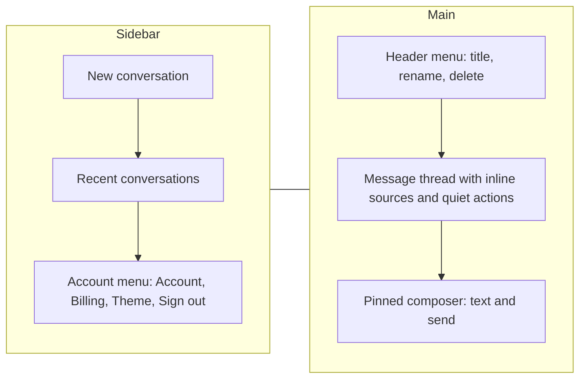
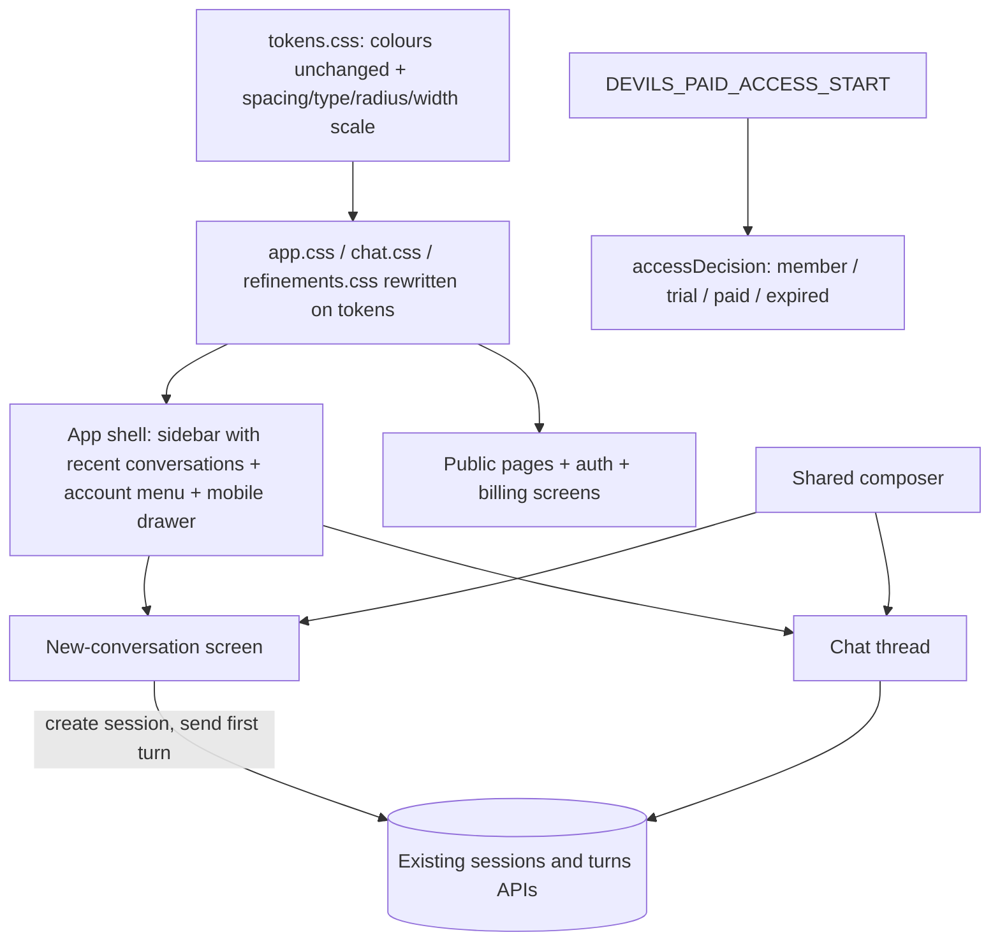

# UI Simplification and Payments Go-Live - Plan

## Goal Capsule

- **Objective:** Anyone opening Devils Advocate, on any screen size, understands each screen at a glance and gets straight to thinking through their idea with no learning curve; new users can pay for the monthly plan once the owner finishes live payment setup.
- **Means:** One shared design system and a familiar chat layout built on the existing app and APIs (KTD1, KTD3), plus a paid-access start date that keeps existing accounts free (KTD7).
- **Product authority:** The owner (Exploitster) decides product scope; the Product Contract below outranks the Planning Contract, which outranks unit detail. This plan covers the public site and app UI plus payments go-live readiness. The knowledge library, the business-case corpus and the bring-your-own-AI free tier are not active scope.
- **Open blockers:** Switching payments on waits on owner-only steps (R17). It does not block any implementation unit.
- **Stop conditions:** Stop and report if a unit would change AI behaviour, prompts, the evidence corpus or the conversation/billing APIs' request contracts, or if keeping a browser test would require deleting or skipping it.
- **Execution profile:** One pull request containing U1–U9. The payments change is inert until the owner sets the go-live settings, so it can merge with the UI work.
- **Who finishes:** The implementing agent lands the code and tests; the owner completes the R17 steps and flips the payment settings using the U8 checklist.

---

## Product Contract

### Summary

One quieter design system, keeping today's colours and theme, applied to every public page and app screen.
Public pages keep their sections with short, story-led copy.
The app adopts the familiar chat layout: conversations in a sidebar, one bottom composer, and a clean thread where guidance appears as light inline actions.
Payments become ready to switch on for new accounts, with existing accounts kept free.

### Problem Frame

The site and app ask people to read too much before they can think.
The homepage stacks nine sections of dense copy (about 7,000px at desktop width).
In a conversation, a clarifying question appears twice, once in the reply and again in a separate panel.
The composer carries a label, a mode dropdown, a character counter, two buttons and a two-line disclaimer.
The desktop sidebar background stops at the viewport height on long pages, and on phones the brand row plus navigation fill roughly a third of the screen before any content.

Pricing of ₹2,000/month and a Subscribe button are shown on the homepage, sign-in screen and Billing page while payments are disabled, so the promise cannot be acted on.
Under the current access rule, turning payments on would immediately block every account older than 24 hours without a paid subscription, including all of today's free users.

### Key Decisions

- **Familiar chat look with the product's guidance kept.** Clarifying questions, sources and decision cards stay because they are what makes the product useful; their presentation moves inline. (session-settled: user-directed — chosen over a pure free-form chat and over tidying the current panel structure: removes the learning curve without dropping the guided validation.) Governs R9, R10, R11, R12, R13.
- **Homepage keeps every section in its current order; polish and copy only.** (session-settled: user-directed — chosen over cutting to a short page and over a one-screen intro that leads straight into chat: the owner wants the full story present.) Governs R4.
- **Payments go-live is part of this plan.** (session-settled: user-directed — chosen over UI now with payments as the next plan, and over payments first: the owner wants others able to pay.) Governs R15, R16, R17, R18.
- **Accounts created before go-live stay free indefinitely.** (session-settled: user-directed — chosen over a grace period with notice, an immediate paywall, and waiting for the bring-your-own-AI option.) Governs R16.
- **Theme stays; no new visual identity or brand assets.** The owner asked to keep the theme. Governs R1.
- **"Story format" means copy that follows the user's arc, not illustrations.** The arc is: an idea, the hard questions, your decision. Governs R2.

### Requirements

**Design system**

- R1. Public pages and app screens share one set of spacing, type scale and component rules; colours and the light/dark themes stay as they are today.
- R2. Copy is short and story-led: each section or empty state leads with one headline and at most two short lines, following the idea → hard questions → your decision arc.
- R3. No content overlaps, clips or scrolls sideways at 375px, 768px, 1280px and 1440px widths, in light and dark themes, and page backgrounds and the sidebar extend the full page height.

**Public site**

- R4. The homepage keeps all current sections in their current order, with spacing, alignment and type corrected and copy trimmed per R2.
- R5. The other public pages (features, how it works, business validation, philosophical reflection, pricing, FAQ, help, contact, security, sources, subscription and cancellation, refunds, accessibility, privacy, terms) and the sign-in, sign-up and password screens follow R1 and R2.

**App shell**

- R6. The sidebar holds New conversation at the top, the user's recent conversations below it, and one account menu at the bottom containing Account, Billing, theme and sign out; on phones it collapses behind a menu button so content starts near the top of the screen.
- R7. Home becomes the new-conversation screen: a short greeting, the composer, a business/personal toggle and a few starter prompts, replacing the current perspective-card panel.
- R8. History remains the page for searching and browsing all conversations.

**Chat**

- R9. A conversation reads as a plain message thread; the assistant's guidance (underlying question, strengths, counterpoints, next step) stays inside the reply as light prose sections, not separate panels.
- R10. A clarifying question appears once, as the assistant's reply, with quick replies to answer or skip it.
- R11. Sources appear as small inline chips in the reply that open the existing source detail.
- R12. Push back, correct my position and make a decision card are quiet actions on the latest reply, replacing the mode dropdown and the separate card button.
- R13. One composer stays pinned at the bottom with only a text box and send; the character count appears only near the limit, and a single short line replaces the two-line disclaimer.
- R14. Conversation title, rename and delete live in a compact header menu instead of an always-visible delete button and rename disclosure.

**Payments**

- R15. The homepage pricing section, the Billing page and the checkout screens follow R1 and R2, and Subscribe remains available.
- R16. When payments are on, accounts created before payments go live keep free access indefinitely, and accounts created afterwards get a 24-hour trial and then need an active subscription to keep generating; history stays readable either way.
- R17. Payments switch on only after the owner has created the live Dodo product with live keys and a webhook secret, applied database migration 004, and completed one real payment; until then the app behaves as today (free access, no live charges).
- R18. The owner receives a go-live checklist that names each owner step from R17, where it is done, and how to confirm it worked.

**Verification**

- R19. Every public page and app screen is covered by browser tests at the R3 widths in both themes, with automated accessibility checks; existing tests are updated to the new wording, and none are removed or skipped.

### Key Flows

- F1. First conversation
  - **Trigger:** A signed-in user opens the app.
  - **Steps:** The new-conversation screen shows a greeting, the composer and starter prompts (R7). The user types or picks a starter and sends. The reply arrives in the thread; if it is a clarifying question, quick replies offer answer or skip (R10). Later replies carry inline source chips (R11) and quiet actions (R12).
  - **Outcome:** The user has an ongoing conversation listed in the sidebar (R6) without having read any instructions.
  - **Covered by:** R6, R7, R9, R10, R11, R12, R13
- F2. Subscribing after go-live
  - **Trigger:** A new account's 24-hour trial ends after payments are switched on (R17).
  - **Steps:** The user is told generation needs a subscription and sees the plan and Subscribe (R15). Checkout completes in Dodo and returns to the app.
  - **Outcome:** Generation resumes; an account created before go-live never sees this flow (R16).
  - **Covered by:** R15, R16, R17

### Screen Layout (directional)



On phones the sidebar sits behind a menu button and the main column fills the screen (R6, R3).

### Acceptance Examples

- AE1. Covers R10.
  - **Given:** A user sends a vague first message.
  - **When:** The assistant needs a clarifying question.
  - **Then:** The question appears once in the thread with answer and skip quick replies, and no second panel repeats it.
- AE2. Covers R16.
  - **Given:** Payments have been switched on.
  - **When:** An account created before go-live and an account created after go-live, past its 24-hour trial, each send a message.
  - **Then:** The older account gets a reply; the newer account is asked to subscribe and can still read its history.
- AE3. Covers R17.
  - **Given:** The owner has not yet completed the live Dodo setup, migration 004 and their own real payment.
  - **When:** Any user opens Billing or sends a message.
  - **Then:** Access stays free as today and no live charge can be started.
- AE4. Covers R3, R6.
  - **Given:** A 375px-wide phone in dark theme.
  - **When:** A user opens a long conversation.
  - **Then:** The thread starts near the top, the composer stays reachable at the bottom, the sidebar opens from a menu button, and nothing scrolls sideways.

### Success Criteria

- A first-time signed-in user can send a first message from the new-conversation screen without instructions.
- The owner reviews the screens at the R3 widths and judges them clean, consistent and light on text.

### Scope Boundaries

- Deferred: the owner knowledge library, the business-case corpus from Crunchbase-like sources, and the bring-your-own-AI free tier (see How This Work Fits Together).
- Deferred: illustrations, a new logo or other new brand assets.
- Deferred: testing on specific physical devices beyond the R3 widths.
- Not in scope: reintroducing a separate staging environment.
- Not in scope: changing the AI behaviour, prompts, evidence corpus or reply content beyond how replies are presented.

<!-- ce-section: work-relationships -->
### How This Work Fits Together

This plan covers the UI simplification and payments go-live. The areas below are the current understanding, not a committed roadmap.

- Owner knowledge library: upload books, MBA notes and professors' documents so replies and validation questions draw on them.
  - Can proceed independently of this plan.
  - Business-case corpus: curated success and failure cases from Crunchbase-like sources. Shares the library's ingestion path. Still to decide: which sources can be used under their terms.
- Bring-your-own-AI free tier: non-paying users connect their own Claude, Gemini or ChatGPT access while this product's prompts and sources drive the answers. Depends on payments being live (R16, R17) to define who is free and who pays. Still to decide: how the connection works per provider.

### Dependencies / Assumptions

- Dodo approves the merchant account for live payments and the ₹2,000 monthly product can be created in live mode.
- "Accounts created before go-live" is defined by the moment payments are switched on.

### Outstanding Questions

**Deferred to Planning**

- Exact copy for each section and empty state, within R2.
- Which three or four starter prompts the new-conversation screen offers (R7).
- How the go-live moment is recorded so R16 can tell older accounts from newer ones.
- How many recent conversations the sidebar lists before pointing to History (R6, R8).

### Sources / Research

- Current UI files: `src/components/session.tsx`, `src/components/app.tsx`, `src/app/home/page.tsx`, `src/app/page.tsx`, `src/components/sample-debate.tsx`, `src/components/pricing.tsx`, `src/lib/site-content.ts`, `src/styles/`.
- Access rule that blocks unpaid accounts when payments are on: `src/lib/auth/access.ts`.
- Payments setup and verification steps: `docs/dodo-payments-setup.md`, `docs/dodo-verification.md`.
- Browser tests that reference current labels: `tests/e2e/`.
- Screenshots and grounding notes (machine-local, best effort): `/tmp/claude-0/-home-user-Devils-App/53a81fd6-08ac-5393-80e9-cdb45bd60262/scratchpad/shots/` and `/tmp/compound-engineering-0/ce-brainstorm/ui-simplify/grounding.md`.

**Product Contract preservation:** Product Contract unchanged.

---

## Planning Contract

### Key Technical Decisions

- KTD1. **Restyle in two passes: consolidate, then apply the system.** `src/styles/app.css` (about 35KB, minified) redefines the same selectors many times (for example `.lead` ten times), which is the source of the inconsistent spacing. U1 merges duplicate rules with no visual change; U2 adds spacing, type, radius and width tokens to `src/styles/tokens.css` and rewrites component rules against them. Colour tokens and the light/dark theme mechanism stay as they are (R1).
- KTD2. **One-step start reuses the existing APIs.** The new-conversation screen creates the session (`POST /api/sessions`) and then sends the first turn (`POST /api/sessions/[id]/turns`) before navigating; no new endpoint. If the turn fails after the session exists, the app opens that session with the typed text restored in the composer (R7, F1).
- KTD3. **One shared composer component** serves the new-conversation screen and the chat, so both get the same pinned, minimal input, keyboard behaviour (Enter sends, Shift+Enter adds a line) and near-limit counter (R13).
- KTD4. **The thinking summary stays conversation-level state.** It is the existing session `state` (underlying question, strengths, counterpoints, next step); it renders as light prose directly under the latest assistant message instead of as a separate block after the thread (R9).
- KTD5. **A pending clarifying question is shown once.** When a clarification is pending, the latest assistant message already carries the question; the separate panel is removed and a quick-reply row (answer focuses the composer, skip sends the existing skip action) sits under that message (R10).
- KTD6. **Reply actions map to the existing turn actions.** Push back and Correct my position set the existing `pushback` / `correction` action and show a removable tag on the composer; Make a decision card calls the existing card generation. No API change (R12).
- KTD7. **Existing accounts are identified by a paid-access start date.** A new setting `DEVILS_PAID_ACCESS_START` (ISO date-time) is required whenever payments are enabled with Dodo; configuration refuses to start without it. An account whose profile `createdAt` is before that moment is allowed with a new access reason `member` and no expiry; everyone else follows today's trial/paid rules (R16, R17). Chosen over a database flag because it needs no migration and the owner sets it in the same step that turns payments on.
- KTD8. **The sidebar lists recent conversations from the existing list endpoint.** It shows the 15 most recent by `updatedAt`, with a link to History for the rest (R6, R8).
- KTD9. **Legal pages keep their wording.** Privacy, Terms, Refunds and Subscription & cancellation get layout fixes only; trimming legal text for brevity could change what it promises (R2, R5).
- KTD10. **Browser tests change with the wording, never by removal.** Selectors that target renamed labels are updated; a new layout suite covers widths and themes (R19).

### High-Level Technical Design



Access decision when payments are enabled with Dodo (directional):

```
profile disabled            -> denied (disabled)
verified live subscription  -> allowed (paid, until period end)
profile.createdAt < start   -> allowed (member, no expiry)
within 24h of createdAt     -> allowed (trial)
otherwise                   -> denied (expired; history stays readable)
```

### Assumptions

- Profile `createdAt` reliably reflects when an account first reached the app; accounts created before the paid-access start therefore stay free.
- The existing sessions list endpoint is fast enough to serve the sidebar for current conversation volumes.

### Sequencing

U1 → U2 → (U3, U6 in parallel) → U4 → U5 → U9. U7 → U8 can run at any point.

---

## Implementation Units

### U1. Consolidate stylesheets without visual change

**Goal:** Remove duplicated and overridden CSS rules so later styling changes land in one place.
**Requirements:** R1 (enabling), KTD1.
**Dependencies:** None.
**Files:** `src/styles/app.css`, `src/styles/chat.css`, `src/styles/refinements.css`, `src/styles/tokens.css`.
**Approach:**
1. Unminify the stylesheets into readable, one-rule-per-block form.
2. Merge repeated selectors so each selector's final computed declarations are preserved, keeping media-query and dark-theme rules in their own blocks.
3. Fold `refinements.css` overrides into the rules they override where that preserves the cascade.
**Execution note:** Prove no visual change by comparing before/after screenshots of the homepage, new-conversation screen and a conversation at 375px and 1440px.
**Patterns to follow:** Existing token usage in `src/styles/tokens.css`.
**Test scenarios:** Test expectation: none -- styling-only refactor with no behaviour change; proven by screenshot comparison and the existing browser suite staying green.
**Verification:** Screenshots match before/after; existing unit and browser tests pass unchanged.

### U2. Apply the shared design system

**Goal:** Give every screen the same spacing, type scale and component rules, and fix layout breakage.
**Requirements:** R1, R3, KTD1.
**Dependencies:** U1.
**Files:** `src/styles/tokens.css`, `src/styles/app.css`, `src/styles/chat.css`, `src/styles/refinements.css`, `src/components/app.tsx`.
**Approach:**
1. Add tokens for a spacing scale, a type scale (body, small, headings), radii and content widths; keep colour tokens untouched.
2. Rewrite component rules (panels, buttons, headings, cards, inputs, notices) to use the tokens, reducing oversized controls and heavy panel framing.
3. Make the sidebar and page background span the full page height, keep the skip link hidden until focused, and remove horizontal overflow sources.
**Patterns to follow:** Existing `[data-theme='dark']` token overrides in `src/styles/tokens.css`.
**Test scenarios:**
- At 375px, the homepage, sign-in page and a conversation have no horizontal scroll (document width equals viewport width).
- On a page taller than the viewport at 1440px, the sidebar background reaches the bottom of the page.
- Before any keyboard focus, the "Skip to content" link is not visible; after pressing Tab it becomes visible.
**Verification:** The listed checks pass in the U9 suite; visual review at the four widths in both themes shows consistent spacing.

### U3. Rebuild the app shell

**Goal:** A sidebar that holds new conversation, recent conversations and one account menu, collapsing behind a menu button on phones.
**Requirements:** R6, R8, AE4, KTD8.
**Dependencies:** U2.
**Files:** `src/components/app.tsx`, `src/styles/app.css`, `tests/e2e/application.spec.ts`, `tests/e2e/accessibility.spec.ts`.
**Approach:**
1. Replace the Home/History/Billing/Account nav and the sidebar tagline with New conversation, a recent-conversations list (15 most recent, current one marked) and an "All conversations" link to History.
2. Move Account, Billing, the theme toggle and Sign out into one account menu at the bottom, opened from the user's name.
3. On narrow screens, hide the sidebar behind a menu button in a slim top bar; the drawer closes on navigation and on Escape.
**Patterns to follow:** Existing `api()` helper and auth fetch in `Shell`; existing `details.site-menu` disclosure pattern on public pages.
**Test scenarios:**
- A signed-in user with three conversations sees all three titles in the sidebar, newest first, and the open conversation is marked as current.
- With more than 15 conversations, only 15 are listed and "All conversations" opens History.
- The account menu opens and contains Account, Billing, theme toggle and Sign out; Sign out returns to the sign-in page.
- At 375px the sidebar is hidden, the menu button opens it, and pressing Escape or choosing a conversation closes it.
- Keyboard users can reach the menu button, conversation links and account menu items in order, and axe reports no violations on the new-conversation screen.
**Verification:** Browser tests above pass; History remains reachable.

### U4. New-conversation screen with one-step start

**Goal:** Home becomes a calm start screen where typing and sending starts the conversation.
**Requirements:** R2, R7, F1, KTD2, KTD3.
**Dependencies:** U3.
**Files:** `src/app/home/page.tsx`, `src/components/composer.tsx` (new), `src/styles/chat.css`, `tests/e2e/mvp.spec.ts`, `tests/e2e/public-onboarding.spec.ts`, `tests/e2e/chat-ux.spec.ts`.
**Approach:**
1. Create the shared composer: auto-growing text box, send button with an accessible "Send" name, Enter to send, Shift+Enter for a new line, counter shown only near the 12,000-character limit, an optional removable mode tag, one short disclaimer line.
2. Replace the perspective cards, topic chips, topic disclosure, inspiration cards and start button with: greeting, composer, a Business / Personal toggle, and three or four starter prompts that fill the composer (including a pricing starter that creates a "Pricing decision" conversation).
3. On send, create the session with the chosen perspective and starter title, send the first turn, then open the conversation; on a failed turn, open the session with the text restored (KTD2).
**Patterns to follow:** Session creation in the current `src/app/home/page.tsx`; turn submission in `generate()` in `src/components/session.tsx`.
**Test scenarios:**
- Typing a message on the new-conversation screen and pressing Enter opens a new conversation that already shows the user's message and the reply.
- Choosing Personal before sending creates a philosophy conversation.
- Choosing the pricing starter creates a conversation titled "Pricing decision" with the business perspective.
- Shift+Enter inserts a new line instead of sending; an empty composer cannot send.
- When the first turn fails after the session is created, the user lands in that conversation with their text still in the composer and an error notice.
- The character counter is hidden for a short message and appears when the text is near the limit.
**Verification:** Browser tests above pass, and existing flows in `mvp.spec.ts` and `public-onboarding.spec.ts` pass with updated selectors.

### U5. Chat thread redesign

**Goal:** A clean message thread with guidance inline, a single question, quiet actions and a pinned composer.
**Requirements:** R9, R10, R11, R12, R13, R14, AE1, KTD3, KTD4, KTD5, KTD6.
**Dependencies:** U4.
**Files:** `src/components/session.tsx`, `src/components/source.tsx`, `src/styles/chat.css`, `tests/e2e/chat-ux.spec.ts`, `tests/e2e/mvp.spec.ts`.
**Approach:**
1. Replace the heading block, privacy tip and rename disclosure with a compact header showing the title and a menu holding Rename and Delete (the existing confirmation dialog stays).
2. Render messages as a plain thread; render source citations as small chips that open the existing source detail.
3. Render the conversation's thinking summary as light prose sections under the latest assistant message (KTD4).
4. Remove the clarifying-question panel; when a clarification is pending, show answer/skip quick replies under the latest assistant message (KTD5).
5. Add quiet actions under the latest assistant reply: Push back, Correct my position, Make a decision card (KTD6); keep decision cards in the thread with their copy and download actions.
6. Use the shared composer pinned to the bottom; keep the empty-conversation starter as one line of guidance plus the existing example button.
**Patterns to follow:** Existing `generate()`, `cancel()` and stale-revision handling in `src/components/session.tsx`; `SourceButton` in `src/components/source.tsx`.
**Test scenarios:**
- Covers AE1. After a vague first message, the clarifying question appears exactly once in the page, with Answer and Skip quick replies under it.
- Choosing Skip sends the existing skip turn and the next reply appears.
- Choosing Push back shows a "Pushing back" tag on the composer; sending saves a turn with the pushback action and clears the tag; removing the tag returns to a normal message.
- Make a decision card produces a card in the thread, and Copy card / Download Markdown still work.
- A reply with citations shows source chips, and activating a chip opens the source detail.
- The header menu renames the conversation and opens the delete confirmation; cancelling keeps the conversation.
- While a reply is generating, Cancel generation is available and the composer keeps the unsent text.
- After a reload, messages, the thinking summary and cards are still shown.
**Verification:** Browser tests above pass; `mvp.spec.ts` pricing and pushback flow passes with updated selectors.

### U6. Public pages, auth and billing screens

**Goal:** Every public page and the sign-in, sign-up, password and billing screens follow the design system with short, story-led copy.
**Requirements:** R2, R4, R5, R15, KTD9.
**Dependencies:** U2.
**Files:** `src/app/page.tsx`, `src/components/sample-debate.tsx`, `src/components/pricing.tsx`, `src/components/local-price.tsx`, `src/lib/site-content.ts`, `src/app/[slug]/page.tsx`, `src/components/auth-screen.tsx`, `src/app/billing/page.tsx`, `src/app/privacy/page.tsx`, `src/app/terms/page.tsx`, `tests/site-content.test.ts`, `tests/e2e/public-content.spec.ts`, `tests/e2e/discovery.spec.ts`.
**Approach:**
1. Keep every homepage section in order (R4); rewrite each section to one headline plus at most two short lines that follow the idea → hard questions → your decision arc, and tighten spacing.
2. Apply the same copy rule to features, how it works, business validation, philosophical reflection, pricing, FAQ, help, contact, security, sources and accessibility pages; keep legal wording unchanged (KTD9).
3. Restyle sign-in, sign-up, forgot and reset password screens; shorten the side story copy and keep the price line short.
4. Restyle the pricing section, Billing page and checkout states; keep Subscribe and the existing test/live labelling logic.
**Patterns to follow:** Existing content structure in `src/lib/site-content.ts` and its tests.
**Test scenarios:**
- Every public page still renders its title, is listed in the sitemap, and keeps its noindex/canonical behaviour.
- The homepage still contains every current section heading in the same order.
- Legal page body text is unchanged from before this work.
- The pricing section still shows ₹2,000/month and a Subscribe action; with payments disabled it still states that live subscriptions are not open.
- Sign-in with email and password still works and Google sign-in is still offered.
**Verification:** Tests above pass; visual review confirms shorter copy and consistent spacing at the four widths.

### U7. Existing-member access rule and go-live guard

**Goal:** When payments are switched on, accounts created before the paid-access start keep free access; payments cannot be switched on without that date.
**Requirements:** R16, R17, AE2, AE3, F2, KTD7.
**Dependencies:** None.
**Files:** `src/lib/config.ts`, `src/lib/auth/access.ts`, `src/lib/contracts.ts`, `src/app/billing/page.tsx`, `.env.example`, `tests/config.test.ts`, `tests/dodo-billing.test.ts`.
**Approach:**
1. Read `DEVILS_PAID_ACCESS_START` as an ISO date-time; when payments are enabled with Dodo, missing or invalid values stop configuration with a clear error.
2. In the Dodo access path, after the paid-subscription check and before the trial check, allow accounts whose profile `createdAt` is before the start with reason `member` and no expiry.
3. Show members on the Billing page as having free access as an existing member, with Subscribe still available.
**Execution note:** Implement the access rule test-first; it controls who can use the product once payments are live.
**Patterns to follow:** Existing Dodo branch and trial calculation in `src/lib/auth/access.ts`; existing validation style in `src/lib/config.ts`.
**Test scenarios:**
- Covers AE2. With payments enabled and a start date, an account created one day before the start is allowed with reason `member`.
- Covers AE2. An account created two days after the start with no subscription is denied with reason `expired`.
- An account created after the start and within 24 hours of creation is allowed with reason `trial`.
- An account with a verified live subscription is allowed with reason `paid` regardless of creation date.
- A disabled profile is denied even if created before the start.
- Covers AE3. With payments disabled, every active account is allowed with reason `free` and the start date is not required.
- Enabling payments with Dodo live mode but no start date fails configuration with a message naming `DEVILS_PAID_ACCESS_START`.
- An unparseable start date fails configuration.
**Verification:** Unit tests above pass; the existing billing and Dodo test suites stay green.

### U8. Payments go-live checklist

**Goal:** The owner can turn on live payments step by step and confirm each step worked.
**Requirements:** R18.
**Dependencies:** U7.
**Files:** `docs/payments-go-live.md` (new), `docs/integrations.md`, `docs/dodo-payments-setup.md`, `README.md`.
**Approach:**
1. List the owner steps in order: live Dodo product (₹2,000 monthly), live API key, webhook endpoint and signing secret, migration 004 via the Supabase setup file, Vercel settings (`DEVILS_DODO_ENVIRONMENT=live_mode`, live product ID, `DEVILS_PAID_ACCESS_START`, then `DEVILS_PAYMENTS_ENABLED=true`), redeploy, and one real payment by the owner.
2. For each step, say where it is done and how to confirm it (for example a 200 webhook delivery, a paid status on the Billing page, an existing account still able to chat).
3. Link the checklist from `docs/integrations.md`, `docs/dodo-payments-setup.md` and the README.
**Test scenarios:** Test expectation: none -- documentation only.
**Verification:** Each R17 step appears with a location and a confirmation check; links resolve.

### U9. Layout and theme verification suite

**Goal:** Prove nothing breaks on any covered screen size or theme.
**Requirements:** R3, R19, AE4.
**Dependencies:** U3, U4, U5, U6.
**Files:** `tests/e2e/layout.spec.ts` (new), `tests/e2e/accessibility.spec.ts`.
**Approach:**
1. For each public page, the sign-in page, the new-conversation screen, a conversation with a reply and card, History, Account and Billing, render at 375, 768, 1280 and 1440px in light and dark themes.
2. Assert no horizontal scroll, no visible element overflowing the viewport, and the composer within the viewport on app screens.
3. Run axe on each page in both themes.
**Patterns to follow:** Existing `@axe-core/playwright` usage in `tests/e2e/accessibility.spec.ts`; local sign-in in `tests/e2e/mvp.spec.ts`.
**Test scenarios:**
- Covers AE4. At 375px in dark theme, a long conversation has no horizontal scroll and the composer is visible at the bottom.
- Every listed page at every width and theme has document width equal to the viewport width.
- Every listed page in both themes has no axe violations at serious or critical impact.
**Verification:** The suite passes locally and in CI.

---

## Verification Contract

- `npm run typecheck`, `npm run lint`, `npm test` (Vitest), `npm run evidence:verify`, `npm run eval` and `npm run build` pass.
- `npm run test:e2e` passes, including the new `tests/e2e/layout.spec.ts`; the CI Clarity and PostHog consent steps still pass.
- `npm run test:db` passes in CI (no SQL changes are planned).
- Screenshots of the homepage, new-conversation screen, a conversation and Billing at 375, 768, 1280 and 1440px in both themes are captured for owner review.

## Definition of Done

- U1–U9 are implemented and their test scenarios exist and pass.
- No browser or unit test was removed or skipped; renamed selectors are updated.
- Legal page wording is unchanged.
- With `DEVILS_PAYMENTS_ENABLED=false`, behaviour matches today (everyone free).
- The go-live checklist exists and is linked.
- Abandoned or experimental code from approaches that did not pan out is removed from the diff.
