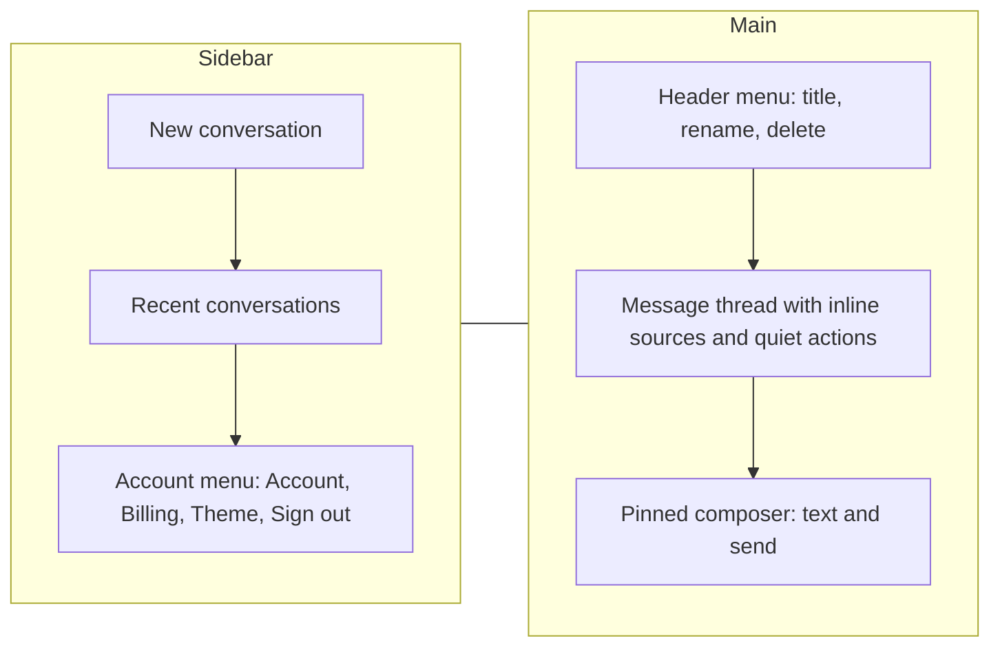

# UI Simplification and Payments Go-Live - Plan

## Goal Capsule

- **Objective:** Anyone opening Devils Advocate, on any screen size, understands each screen at a glance and gets straight to thinking through their idea with no learning curve; new users can pay for the monthly plan once the owner finishes live payment setup.
- **Product authority:** The owner (Exploitster). This plan covers the public site and app UI plus payments go-live readiness. The knowledge library, the business-case corpus and the bring-your-own-AI free tier are not active scope.
- **Open blockers:** Switching payments on waits on owner-only steps (R17). It does not block the UI work.

---

## Product Contract

### Summary

One quieter design system, keeping today's colours and theme, applied to every public page and app screen.
Public pages keep their sections with short, story-led copy.
The app adopts the familiar chat layout: conversations in a sidebar, one bottom composer, and a clean thread where guidance appears as light inline actions.
Payments become ready to switch on for new accounts, with existing accounts kept free.

### Problem Frame

The site and app ask people to read too much before they can think.
The homepage stacks nine sections of dense copy (about 7,000px at desktop width).
In a conversation, a clarifying question appears twice, once in the reply and again in a separate panel.
The composer carries a label, a mode dropdown, a character counter, two buttons and a two-line disclaimer.
The desktop sidebar background stops at the viewport height on long pages, and on phones the brand row plus navigation fill roughly a third of the screen before any content.

Pricing of ₹2,000/month and a Subscribe button are shown on the homepage, sign-in screen and Billing page while payments are disabled, so the promise cannot be acted on.
Under the current access rule, turning payments on would immediately block every account older than 24 hours without a paid subscription, including all of today's free users.

### Key Decisions

- **Familiar chat look with the product's guidance kept.** Clarifying questions, sources and decision cards stay because they are what makes the product useful; their presentation moves inline. (session-settled: user-directed — chosen over a pure free-form chat and over tidying the current panel structure: removes the learning curve without dropping the guided validation.) Governs R9, R10, R11, R12, R13.
- **Homepage keeps every section in its current order; polish and copy only.** (session-settled: user-directed — chosen over cutting to a short page and over a one-screen intro that leads straight into chat: the owner wants the full story present.) Governs R4.
- **Payments go-live is part of this plan.** (session-settled: user-directed — chosen over UI now with payments as the next plan, and over payments first: the owner wants others able to pay.) Governs R15, R16, R17, R18.
- **Accounts created before go-live stay free indefinitely.** (session-settled: user-directed — chosen over a grace period with notice, an immediate paywall, and waiting for the bring-your-own-AI option.) Governs R16.
- **Theme stays; no new visual identity or brand assets.** The owner asked to keep the theme. Governs R1.
- **"Story format" means copy that follows the user's arc, not illustrations.** The arc is: an idea, the hard questions, your decision. Governs R2.

### Requirements

**Design system**

- R1. Public pages and app screens share one set of spacing, type scale and component rules; colours and the light/dark themes stay as they are today.
- R2. Copy is short and story-led: each section or empty state leads with one headline and at most two short lines, following the idea → hard questions → your decision arc.
- R3. No content overlaps, clips or scrolls sideways at 375px, 768px, 1280px and 1440px widths, in light and dark themes, and page backgrounds and the sidebar extend the full page height.

**Public site**

- R4. The homepage keeps all current sections in their current order, with spacing, alignment and type corrected and copy trimmed per R2.
- R5. The other public pages (features, how it works, business validation, philosophical reflection, pricing, FAQ, help, contact, security, sources, subscription and cancellation, refunds, accessibility, privacy, terms) and the sign-in, sign-up and password screens follow R1 and R2.

**App shell**

- R6. The sidebar holds New conversation at the top, the user's recent conversations below it, and one account menu at the bottom containing Account, Billing, theme and sign out; on phones it collapses behind a menu button so content starts near the top of the screen.
- R7. Home becomes the new-conversation screen: a short greeting, the composer, a business/personal toggle and a few starter prompts, replacing the current perspective-card panel.
- R8. History remains the page for searching and browsing all conversations.

**Chat**

- R9. A conversation reads as a plain message thread; the assistant's guidance (underlying question, strengths, counterpoints, next step) stays inside the reply as light prose sections, not separate panels.
- R10. A clarifying question appears once, as the assistant's reply, with quick replies to answer or skip it.
- R11. Sources appear as small inline chips in the reply that open the existing source detail.
- R12. Push back, correct my position and make a decision card are quiet actions on the latest reply, replacing the mode dropdown and the separate card button.
- R13. One composer stays pinned at the bottom with only a text box and send; the character count appears only near the limit, and a single short line replaces the two-line disclaimer.
- R14. Conversation title, rename and delete live in a compact header menu instead of an always-visible delete button and rename disclosure.

**Payments**

- R15. The homepage pricing section, the Billing page and the checkout screens follow R1 and R2, and Subscribe remains available.
- R16. When payments are on, accounts created before payments go live keep free access indefinitely, and accounts created afterwards get a 24-hour trial and then need an active subscription to keep generating; history stays readable either way.
- R17. Payments switch on only after the owner has created the live Dodo product with live keys and a webhook secret, applied database migration 004, and completed one real payment; until then the app behaves as today (free access, no live charges).
- R18. The owner receives a go-live checklist that names each owner step from R17, where it is done, and how to confirm it worked.

**Verification**

- R19. Every public page and app screen is covered by browser tests at the R3 widths in both themes, with automated accessibility checks; existing tests are updated to the new wording, and none are removed or skipped.

### Key Flows

- F1. First conversation
  - **Trigger:** A signed-in user opens the app.
  - **Steps:** The new-conversation screen shows a greeting, the composer and starter prompts (R7). The user types or picks a starter and sends. The reply arrives in the thread; if it is a clarifying question, quick replies offer answer or skip (R10). Later replies carry inline source chips (R11) and quiet actions (R12).
  - **Outcome:** The user has an ongoing conversation listed in the sidebar (R6) without having read any instructions.
  - **Covered by:** R6, R7, R9, R10, R11, R12, R13
- F2. Subscribing after go-live
  - **Trigger:** A new account's 24-hour trial ends after payments are switched on (R17).
  - **Steps:** The user is told generation needs a subscription and sees the plan and Subscribe (R15). Checkout completes in Dodo and returns to the app.
  - **Outcome:** Generation resumes; an account created before go-live never sees this flow (R16).
  - **Covered by:** R15, R16, R17

### Screen Layout (directional)

On phones the sidebar sits behind a menu button and the main column fills the screen (R6, R3).

### Acceptance Examples

- AE1. Covers R10.
  - **Given:** A user sends a vague first message.
  - **When:** The assistant needs a clarifying question.
  - **Then:** The question appears once in the thread with answer and skip quick replies, and no second panel repeats it.
- AE2. Covers R16.
  - **Given:** Payments have been switched on.
  - **When:** An account created before go-live and an account created after go-live, past its 24-hour trial, each send a message.
  - **Then:** The older account gets a reply; the newer account is asked to subscribe and can still read its history.
- AE3. Covers R17.
  - **Given:** The owner has not yet completed the live Dodo setup, migration 004 and their own real payment.
  - **When:** Any user opens Billing or sends a message.
  - **Then:** Access stays free as today and no live charge can be started.
- AE4. Covers R3, R6.
  - **Given:** A 375px-wide phone in dark theme.
  - **When:** A user opens a long conversation.
  - **Then:** The thread starts near the top, the composer stays reachable at the bottom, the sidebar opens from a menu button, and nothing scrolls sideways.

### Success Criteria

- A first-time signed-in user can send a first message from the new-conversation screen without instructions.
- The owner reviews the screens at the R3 widths and judges them clean, consistent and light on text.

### Scope Boundaries

- Deferred: the owner knowledge library, the business-case corpus from Crunchbase-like sources, and the bring-your-own-AI free tier (see How This Work Fits Together).
- Deferred: illustrations, a new logo or other new brand assets.
- Deferred: testing on specific physical devices beyond the R3 widths.
- Not in scope: reintroducing a separate staging environment.
- Not in scope: changing the AI behaviour, prompts, evidence corpus or reply content beyond how replies are presented.

<!-- ce-section: work-relationships -->
### How This Work Fits Together

This plan covers the UI simplification and payments go-live. The areas below are the current understanding, not a committed roadmap.

- Owner knowledge library: upload books, MBA notes and professors' documents so replies and validation questions draw on them.
  - Can proceed independently of this plan.
  - Business-case corpus: curated success and failure cases from Crunchbase-like sources. Shares the library's ingestion path. Still to decide: which sources can be used under their terms.
- Bring-your-own-AI free tier: non-paying users connect their own Claude, Gemini or ChatGPT access while this product's prompts and sources drive the answers. Depends on payments being live (R16, R17) to define who is free and who pays. Still to decide: how the connection works per provider.

### Dependencies / Assumptions

- Dodo approves the merchant account for live payments and the ₹2,000 monthly product can be created in live mode.
- "Accounts created before go-live" is defined by the moment payments are switched on.

### Outstanding Questions

**Deferred to Planning**

- Exact copy for each section and empty state, within R2.
- Which three or four starter prompts the new-conversation screen offers (R7).
- How the go-live moment is recorded so R16 can tell older accounts from newer ones.
- How many recent conversations the sidebar lists before pointing to History (R6, R8).

### Sources / Research

- Current UI files: `src/components/session.tsx`, `src/components/app.tsx`, `src/app/home/page.tsx`, `src/app/page.tsx`, `src/components/sample-debate.tsx`, `src/components/pricing.tsx`, `src/lib/site-content.ts`, `src/styles/`.
- Access rule that blocks unpaid accounts when payments are on: `src/lib/auth/access.ts`.
- Payments setup and verification steps: `docs/dodo-payments-setup.md`, `docs/dodo-verification.md`.
- Browser tests that reference current labels: `tests/e2e/`.
- Screenshots and grounding notes (machine-local, best effort): `/tmp/claude-0/-home-user-Devils-App/53a81fd6-08ac-5393-80e9-cdb45bd60262/scratchpad/shots/` and `/tmp/compound-engineering-0/ce-brainstorm/ui-simplify/grounding.md`.
