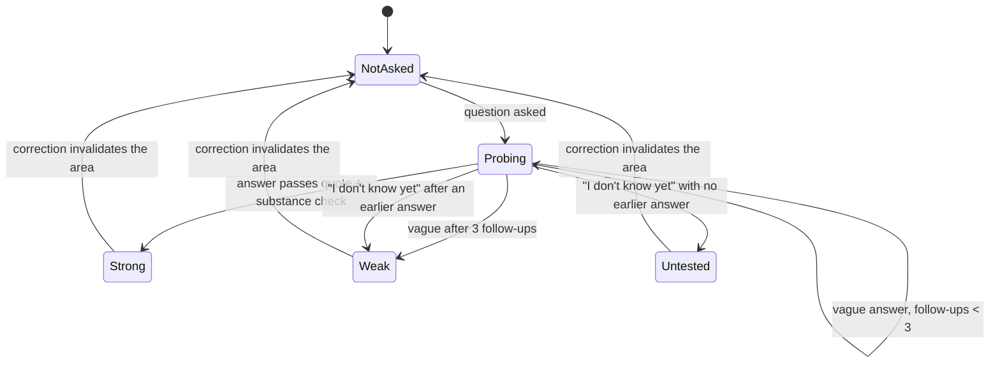
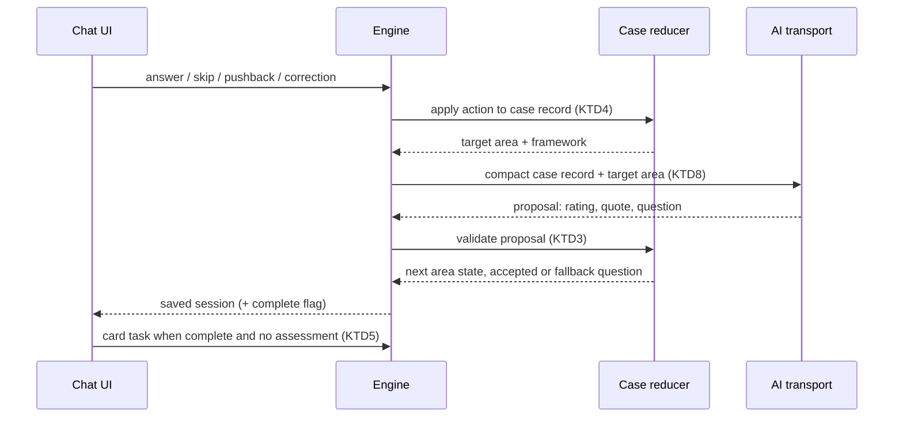

# Case Prep Conversation - Plan

## Goal Capsule

- **Objective:** A person who brings a business idea or a personal decision does the thinking themselves. They answer guiding questions area by area, and finish with an assessment that shows which parts of their reasoning are strong, weak or untested.
- **Means:** Replace today's describe, clarify, debate and card flow with a case-prep conversation whose area state the app owns while the AI proposes questions and judgements (KTD1, KTD3).
- **Product authority:** The Product Contract below holds the owner's decisions; on product behaviour an R-ID wins, and on mechanism a KTD wins within its R-IDs. Bring-your-own-AI, the owner knowledge library, the feedback flag and the admin pages are not active scope here (see How This Work Fits Together).
- **Execution profile:** One pull request into `main`. Payments stay as they are; nothing here touches billing or access rules.
- **Stop conditions:** Stop and report rather than improvise if Philosophy Stack Exchange snapshots cannot be obtained without scraping (U6), or if a model provider cannot return the case-prep proposal shape within its structured-output limits (U3).
- **Who finishes:** `ce-work` implements and verifies; the owner reviews and merges.
- **Open blockers:** None.

---

## Product Contract

### Summary

Every new conversation becomes case prep. The assistant works through a fixed set of areas, nine for a business idea and seven for a personal decision. It asks one simple guiding question at a time, built on the person's own words, and probes weak answers until they are solid or the person says they don't know yet. Once every area is covered, the person receives an assessment document. It scores each area, names the loopholes, the good and the bad, and what must be true. It leaves the decision with them.

### Problem Frame

Today a conversation asks at most three clarifying questions and then argues back with sourced counterpoints. The assistant does most of the thinking, and the person reads it. Founders and people facing a hard choice learn little from being told what is wrong. What changes their thinking is being made to answer the questions an experienced mentor or case interviewer would ask: who exactly is this for, how do you know, what did you test. The current flow skips most of those questions, so ideas leave the conversation with untested assumptions the person never had to confront.

### Key Decisions

- **Case prep first; connecting your own AI is the next plan.** Payments are still off, so everyone already uses the app for free; the guided conversation is the product's core value. (session-settled: user-directed — chosen over building bring-your-own-AI first or both together: core value before a free-usage path that matters only once payments are on.)
- **Case prep replaces the current flow.** Sourced counterpoints move into the assessment's loopholes section. Governs R1, R16. (session-settled: user-directed — chosen over a separate case-prep option beside the quick debate, and over questions followed by the debate: one clear experience.)
- **A full case, not a quick check.** A typical session runs about 10-15 questions, and follow-ups may take it further. Governs R8. (session-settled: user-directed — chosen over a short 5-7 question check and over an open-ended adaptive length.)
- **Follow-ups always win over session length.** Governs R6, R8. (session-settled: user-directed — chosen over a hard cap near 15 questions and over letting the person pick quick or deep at the start.)
- **Weak answers are probed until solid, with an escape hatch.** Governs R6, R7. (session-settled: user-directed — chosen over one nudge then move on, and over accepting the answer silently; up to 3 follow-ups plus "I don't know yet" was chosen over either limit alone.)
- **The assessment judges each area but gives no go/no-go.** "Your call. Always." stays. Governs R13, R14. (session-settled: user-directed — chosen over an explicit Go / Don't go / Test first verdict and over a labelled recommendation: keeps the product's promise and the current spec.)
- **Nine business areas and seven philosophy areas.** Governs R2, R3. (session-settled: user-directed — the business list was chosen over covering only the five areas named in the request; the philosophy list was chosen over a lighter 5-8 question variant.)
- **Tracked areas with adaptive questions.** The app tracks each area's state and enforces coverage, follow-up limits and "I don't know yet". The assistant writes each question from the conversation. Governs R4, R5, R6, R7, R8. (session-settled: user-directed — chosen over a scripted question bank and over a pre-mortem-first order.)
- **Question frameworks plus licensed forum threads, not scraped forums.** Governs R17, R18. (session-settled: user-directed — chosen over frameworks only and over scraping Reddit or Quora, whose terms forbid it.)
- **Success means people come back.** Governs R21. (session-settled: user-directed — chosen over completion rate, answers getting sharper, and conversion to paid.)
- **Conversations from before case prep become read-only.** They show exactly as before, with a button that starts a new case from the same idea. Governs R16, R22. (session-settled: user-directed — chosen over keeping old conversations continuable in the old flow: one engine to maintain.)
- **Philosophy Stack Exchange only, for now.** Startups Stack Exchange closed in 2017, so its posts cannot carry the live links the licence requires; business questions rely on the written frameworks until the owner library arrives. Governs R18. (session-settled: user-approved — chosen over including the closed Startups site through a legacy dump: attribution cannot be met.)
- **A correction re-judges, it does not restart.** When the person corrects their position, earlier answers stay visible. The assistant re-asks only the areas whose answers no longer fit the new position. Governs R10.

### Requirements

**The case-prep conversation**

- R1. Every new conversation, in both perspectives, runs as case prep: each assistant turn asks one guiding question rather than giving analysis or answers.
- R2. A business case covers nine areas, in this order: the problem and why now; who the customer is; market size; what people use today (alternatives and competitors); the MVP; how it was validated (evidence, not opinions); how it makes money; how it reaches customers; and why this founder.
- R3. A personal-decision case covers seven areas: what is really being decided; what matters most (values); options not yet considered; assumptions; who else is affected; what they would regret; and how reversible the choice is.
- R4. Each question is short, in plain language, about one thing, and built on the person's own earlier words. It points the person's thinking somewhere without containing the answer.
- R5. Each area has one of five states, which the assistant decides after every answer: not asked, probing, strong, weak, or untested.
- R6. A vague or weak answer gets a follow-up that narrows it, up to three follow-ups per area. An area still weak after three follow-ups is recorded as weak and the case moves on.
- R7. Every question offers an "I don't know yet" reply. It marks the area untested at once and moves to the next area.
- R8. Every area gets at least one question before the case counts as complete, and follow-ups are never cut short because the session has passed 15 questions.
- R9. The person can always see which areas are done and which remain, and the state of each finished area.
- R10. Push back and correct my position stay available during questioning, and a correction re-asks only the areas whose earlier answers no longer fit.
- R11. The person can ask for the assessment at any time. Areas never asked then show as "not covered".

**The assessment document**

- R12. When every area is covered, the assistant produces the assessment document without being asked and tells the person it is ready.
- R13. The assessment contains:
  - a one-line statement of the idea or decision;
  - each area's score (strong, weak, untested or not covered) with a one-sentence reason that quotes the person's answer;
  - loopholes, including up to three source-backed counterpoints under today's evidence rules;
  - what is good and what is bad;
  - what must be true for it to work;
  - one suggested next step for each weak or untested area;
  - the closing "Your call. Always.".
- R14. The assessment never gives an overall verdict, a go/no-go, a score out of 10, or a probability of success.
- R15. The assessment is saved with the conversation, opens from history, and downloads as Markdown, like today's hand-back card.
- R16. New conversations produce the assessment in place of the hand-back card, and conversations saved before this change stay readable as they are.
- R22. A conversation saved before this change opens read-only, and offers a "Start a case" button that begins a new case-prep conversation from the same idea.

**Knowledge behind the questions**

- R17. Each area has a written question framework for both perspectives, drawn from established methods (customer discovery, case-interview structure, classic philosophical questions). It states what the area must establish, what a strong answer shows, and typical follow-ups.
- R18. The source library gains a first reviewed set of Philosophy Stack Exchange threads, quoted word for word under CC BY-SA with the author, a link to the post and the licence shown beside each excerpt, through the same review and licence process as today's sources.
- R19. Questions may draw on the frameworks and the reviewed library. Any claim cited in the assessment comes only from reviewed sources, as today.
- R20. The product spec and bot-behaviour docs describe case prep in place of the three-clarifying-questions-then-debate flow.

**Measuring success**

- R21. The owner can see what share of people who complete a case start another one within 30 days. This is worked out from saved conversations, with no new tracking inside the app.

### Key Flows

- F1. Business case-prep session
  - **Trigger:** A person starts a conversation with a business idea.
  - **Steps:**
    - The assistant asks about the problem first, then works through the remaining areas in order.
    - Each answer updates its area's state. Weak answers get narrowing follow-ups, and "I don't know yet" skips ahead.
    - Progress stays visible throughout.
    - When the last area is covered, the assessment arrives in the thread.
  - **Outcome:** An assessment scoring all nine areas, saved with the conversation.
  - **Covered by:** R1, R2, R4, R5, R6, R7, R8, R9, R12, R13.
- F2. Early assessment
  - **Trigger:** The person asks for the assessment before every area is covered.
  - **Steps:**
    - The assistant produces the assessment from the answers so far.
    - Areas never asked are marked "not covered".
    - The person can carry on answering afterwards and request an updated assessment.
  - **Covered by:** R11, R13.

### Acceptance Examples

- AE1. **Covers R6.**
  - **Given:** the customer area.
  - **When:** the founder answers "everyone who has a clinic, I guess".
  - **Then:** the next question narrows it, for example "Picture the first clinic that would pay: how many doctors, and where?", and the area stays in probing.
- AE2. **Covers R6.**
  - **Given:** three follow-ups on the market area still produce no figure or reasoning.
  - **When:** the third follow-up is answered vaguely.
  - **Then:** the market area is recorded as weak and the next question moves to alternatives and competitors.
- AE3. **Covers R7.**
  - **When:** the founder taps "I don't know yet" on the validation question.
  - **Then:** validation is marked untested at once.
  - **And:** the assessment later suggests one way to find out, such as five customer interviews.
- AE4. **Covers R11.**
  - **Given:** five of nine areas are covered.
  - **When:** the person asks for the assessment.
  - **Then:** the assessment scores those five and marks the other four "not covered".
- AE5. **Covers R10.**
  - **Given:** the customer and market areas are answered.
  - **When:** the founder corrects their position from clinics to dental practices.
  - **Then:** the customer and market areas are asked again, and the problem area keeps its earlier answer.
- AE6. **Covers R14.**
  - **Given:** every area is weak.
  - **When:** the assessment is written.
  - **Then:** it lists the weaknesses and next steps but does not say "don't do this".
- AE7. **Covers R16, R22.**
  - **When:** someone opens a conversation saved last month.
  - **Then:** they see the old thread and hand-back card as before, with no composer.
  - **And:** "Start a case" opens a new case-prep conversation whose first answer is their old idea.

### Success Criteria

- Within a month of launch, the share of people who start a second case within 30 days of completing one is visible to the owner and is the headline measure (R21).
- Questions read as a mentor would ask them: one idea each, built on the person's words, and never containing the answer. Offline evaluation cases check this for both perspectives.

### Scope Boundaries

**Deferred for later**

- Connecting your own ChatGPT, Claude or Gemini (the next plan).
- The owner knowledge library (uploading books and notes) and a curated business-case corpus.
- A pre-mortem opening question ("it's a year later and this failed; why?").
- A per-person limit on AI usage; the existing daily spend limit is the only cost guard.
- Scores that compare a person against other founders.

**Outside this product's identity**

- A go/no-go verdict, win probability or overall score.
- Content scraped from forums whose terms forbid reuse, such as Reddit and Quora.

<!-- ce-section: work-relationships -->
### How This Work Fits Together

This plan covers the case-prep conversation. The areas below are the current understanding, not a committed roadmap.

- Bring your own AI: people connect their ChatGPT, Claude or Gemini and use the app without paying.
  - Can proceed independently of this plan.
  - Shares the conversation engine this plan reshapes.
  - Still to decide: what "one click" can honestly mean per provider, since consumer chat subscriptions cannot be used by other apps. API keys, or a sign-in through a router service, are the realistic routes.
- Owner knowledge studio: the owner uploads notes and recordings (transcribed) into a private library that questions and assessments draw on, and edits the question frameworks from an owner-only page.
  - Enables richer frameworks for this plan's areas; this plan keeps the frameworks in one place so that page can edit them later.
  - Still to decide: transcription provider, and which books or documents can be used under their terms.
- Feedback flag: people flag a reply or assessment as wrong; each flag is checked against the library and reviewed sources, and only owner-approved corrections enter the library.
  - Depends on the owner knowledge studio.

### Dependencies / Assumptions

- A live AI provider is configured in production. Each question is one AI call, so a full case costs several times a chat turn today, and the existing daily spend limit is the cost guard.
- Stack Exchange content is available under CC BY-SA with attribution to the author and a link to the source.
- Existing conversations keep their stored state. Nothing is migrated.

### Sources / Research

- Current conversation phases and question cap: `src/lib/contracts.ts` (phase enum, clarifications max 3) and `src/lib/conversation/state.ts` (one new clarification per response, three total).
- Model rules forbidding verdicts and capping clarifications: `src/lib/model/provider.ts`.
- Product rule against verdicts: `docs/specs/devils-advocate-brief.txt` (lines 20, 139, 305).
- Hand-back card shape: `src/lib/contracts.ts` (`HandBackCardSchema`).
- Evidence review and licence process: `docs/evidence.md`, `data/evidence/seed.json`, `scripts/evidence-import.ts`.
- Analytics run only on public pages after consent: `src/lib/analytics-consent.ts` (why R21 uses saved conversations).
- Prior plan that named bring-your-own-AI as future work: `docs/plans/2026-11-07-1259-feat-ui-simplification-and-payments-go-live-plan.md`.

---

## Planning Contract

**Product Contract preservation:** changed: R18 — Startups Stack Exchange is closed, so the first set is Philosophy Stack Exchange only (user-approved); added R22 and widened AE7 — read-only legacy conversations with "Start a case" (user-directed during planning). The four deferred questions are resolved in KTD5, KTD9 and KTD12 below.

### Key Technical Decisions

- KTD1. **Case-prep state lives in an optional `casePrep` object inside the conversation's saved state, created by the engine on the first turn.** A conversation with messages and no `casePrep` is legacy. This needs no database migration and no change to how sessions are created, because state is stored as one JSON document (`supabase/migrations/001_application.sql`, `src/lib/store/local.ts`). Governs R1, R16, R22.
- KTD2. **One area catalogue feeds everything.** `src/lib/case-prep/frameworks.ts` holds, per perspective, the ordered areas with their label, what the area must establish, strong-answer signals, follow-up patterns and a fallback opening question. The reducer, prompts, simulated AI, progress view and assessment all read it, and it is plain data so plan 2's admin page can later edit it. Governs R2, R3, R17.
- KTD3. **The app chooses the target area before the AI is called; the AI only proposes.** Each turn the AI receives the target area, its framework and the area record, and returns a proposal: a rating of the latest answer (strong, weak or vague), a quote from that answer, and one question for the target area. The app accepts a "strong" rating only when the quote is a verbatim substring of the answer and the answer clears a substance floor (at least about 8 words). It accepts the question only when it is a single question ending in "?" that does not restate a framework's strong-answer signals as an answer. Otherwise it uses the area's fallback question. Follow-up counts and area transitions are the app's alone. Governs R4, R5, R6, R8.
- KTD4. **Actions map onto the existing turn actions.** "I don't know yet" is the existing `skip`: the area becomes untested, or weak when it already holds an earlier answer. `pushback` keeps the area and asks the AI to explain or rephrase the current question. `correction` replaces the position, and the AI proposes which answered areas no longer fit; the app resets those to not asked and keeps the rest. The simulated AI resets every answered area except the first. Governs R7, R10.
- KTD5. **The assessment runs through the existing card task as its own call, which the client starts automatically once every area is covered.** The app writes the per-area scores, quoted reasons and next-step slots from the case record. The AI writes only the prose (one-line statement, good, bad, what must be true, loopholes); loophole counterpoints pass the existing evidence validation unchanged. An area still being probed when an early assessment is requested scores weak with the reason "still being explored". If the AI call fails, or the spend limit refuses it, the app saves a plainer assessment built from the record, marked so the person can regenerate it. Only the latest assessment is kept, in `casePrep.assessment`; storing it in state avoids changing the card commit path in both stores and the SQL function, which a separate assessments list would need. Governs R11, R12, R13, R14, R15.
- KTD6. **One proposal schema shared by all three AI transports.** The case-prep proposal is defined once and added to `ModelOutputSchema` (Gemini), `RouterEnvelopeSchema` and its decoder (OpenRouter and Gateway). The prompt versions are bumped and the case-prep instructions replace the old clarify-then-debate rules. The Gemini schema cleaner must accept every construct the proposal uses.
- KTD7. **The old engine is retired.** Turn and card requests on a legacy conversation are refused with a clear "read-only" error, and the clarifying and debate logic, `nextClarification` and the playbooks are removed once nothing calls them. Governs R16, R22. (session-settled: user-directed — chosen over keeping old conversations continuable: one engine to maintain.)
- KTD8. **The AI sees a compact case record, not the whole transcript.** Each area keeps up to three bounded answer quotes (about 500 characters each), so a long case still works within the 24-message context window. The assessment is written from this record. Governs R13.
- KTD9. **The assessment gets its own, larger output budget.** It uses `DEVILS_MAX_ASSESSMENT_TOKENS` (default 6000), separate from the 2500-token turn budget. The daily spend limit is unchanged.
- KTD10. **A safety pause holds the case.** The support phase leaves `casePrep` untouched. The next ordinary message resumes the current area, and an assessment can still be requested from the record. Governs R1.
- KTD11. **Stack Exchange attribution is a structured field, quoted verbatim.** `EvidenceSchema` gains an optional `attribution` (site, post URL, authors with profile URLs, licence name and URL by post date). Stack Exchange records allow quotes and never paraphrase, to avoid creating an adaptation. Attribution shows in the source dialog and the Markdown export. Snapshots are saved by hand: no data dump, API bulk pull or scraping. Governs R18, R19.
- KTD12. **The return rate is an owner-run report.** `scripts/case-prep-return-rate.ts` reads every saved conversation (service-role Supabase, or the local SQLite file in local mode) and prints completions, returns and the rate. A completion is a full assessment written after every area was covered. A return is the same person starting a new case-prep conversation within 30 days of that completion. Deleted conversations and accounts drop out. Governs R21.

### High-Level Technical Design

Area lifecycle, owned by the app (KTD3, KTD4):

One turn, end to end:

### System-Wide Impact

- **Sessions API:** turn and card routes keep their request shapes; legacy sessions now return a read-only error, which the chat UI handles (U4, U5).
- **Stored data:** new conversations save the case record and assessment inside session state; nothing is migrated, and conversation deletion removes them as today (`docs/privacy.md` updated in U9).
- **AI prompts and cost:** every turn and the assessment change prompt shape and size; spend reservations follow automatically because `reserveCost` serialises the real request.
- **Evidence:** the citation rules and validation stay as they are; only attribution is added (KTD11).
- **Public site:** homepage, pricing and the sample conversation change wording (U9); info and legal pages keep their content.

### Assumptions

- Philosophy Stack Exchange post pages can be read from the build environment, or the owner can save snapshots by hand. If neither works, U6 stops (Goal Capsule).
- Answers of about eight words or more are a fair substance floor for "strong". The offline evaluation cases tune it.

### Risks & Dependencies

| Risk | Mitigation |
|---|---|
| AI proposals drift from the schema on one transport | One shared schema (KTD6); transport tests per provider; one retry already exists for invalid output |
| A full case costs more than expected | One call per question plus the assessment; spend limit unchanged; the return-rate report and usage events show actual cost |
| Bad AI questions leak answers | Controller check plus framework fallback (KTD3); evaluation cases assert one question per turn |
| Removing the old engine breaks tests broadly | U4 removes it only after U2/U3 land; seven e2e specs are rewritten in U5 |

---

## Implementation Units

### U1. Area catalogue and case-prep contracts

- **Goal:** Define the nine business and seven philosophy areas as data, and the case-prep record, proposal and assessment shapes.
- **Requirements:** R2, R3, R5, R13, R17; KTD1, KTD2, KTD6, KTD8.
- **Dependencies:** None.
- **Files:**
  - `src/lib/case-prep/frameworks.ts` (new)
  - `src/lib/contracts.ts`
  - `tests/case-prep-frameworks.test.ts` (new)
- **Approach:**
  1. Write each area's label, what it must establish, strong-answer signals, follow-up patterns and fallback question, drawn from customer discovery, case-interview structure and classic philosophical questions.
  2. Add optional `casePrep` to `SessionStateSchema`: perspective, areas (id, state, follow-up count, bounded quotes), current area, complete flag, assessment.
  3. Add the proposal schema and the assessment schema; keep every new field optional on the state so legacy rows still parse.
- **Patterns to follow:** strict Zod shapes in `src/lib/contracts.ts`; playbook text in `src/lib/model/playbooks.ts`.
- **Test scenarios:**
  - The business catalogue lists exactly the nine areas in the R2 order; philosophy lists the seven R3 areas.
  - Every area has a non-empty fallback question that ends in "?".
  - A legacy session state (no `casePrep`) still parses with `SessionStateSchema`.
  - A state with a full `casePrep` record and an assessment parses; an unknown area id is rejected.
- **Verification:** Schema and catalogue tests pass; typecheck clean.

### U2. Case-prep reducer

- **Goal:** The app-owned area state machine: choose the target area, apply actions, validate proposals, count follow-ups, detect completion.
- **Requirements:** R4, R5, R6, R7, R8, R10, R11; KTD3, KTD4, KTD8, KTD10; F1, F2.
- **Dependencies:** U1.
- **Files:**
  - `src/lib/case-prep/reducer.ts` (new)
  - `tests/case-prep-reducer.test.ts` (new)
- **Approach:**
  1. `startCase` builds the record from the catalogue and the first message; the first message counts as the opening answer to the first area.
  2. `nextTarget` returns the current probing area, else the first area not asked.
  3. `applyAction` handles answer, skip, pushback and correction per KTD4.
  4. `acceptProposal` validates rating, quote and question per KTD3, stores the bounded quote, increments follow-ups, transitions the area, and falls back to the framework question when needed.
  5. `isComplete` is true when no area is not asked or probing.
- **Execution note:** Implement test-first; the reducer is pure and carries the product rules.
- **Patterns to follow:** `controlOutput` and `prepareState` in `src/lib/conversation/state.ts` (the app overrides the model).
- **Test scenarios:**
  - Covers AE1. A vague customer answer keeps the area probing and the next target stays customer.
  - Covers AE2. A third vague follow-up marks market weak and the target moves to alternatives.
  - Covers AE3. Skip on an unanswered area marks it untested and moves on.
  - Skip on an area that already holds an answer marks it weak.
  - A "strong" rating with a quote not found in the answer is downgraded to vague.
  - A "strong" rating on a three-word answer is downgraded to vague.
  - A proposed question with two question marks, or none, is replaced by the fallback.
  - Covers AE5. A correction that invalidates customer and market resets those two and keeps the problem answer.
  - Pushback leaves the area state and follow-up count unchanged.
  - Follow-ups past fifteen total questions are still allowed (R8).
  - Completion is reached only when every area is strong, weak or untested.
  - Quotes are capped at three per area and about 500 characters each.
- **Verification:** Reducer tests pass; no reducer code path calls a model.

### U3. AI contract and prompts

- **Goal:** All three transports carry the case-prep proposal and the assessment prose, with case-prep instructions in place of the old flow's.
- **Requirements:** R1, R4, R13, R14, R19; KTD5, KTD6, KTD8, KTD9.
- **Dependencies:** U1.
- **Files:**
  - `src/lib/model/provider.ts`
  - `src/lib/model/request.ts`
  - `src/lib/model/openrouter-request.ts`
  - `src/lib/model/gateway-request.ts`
  - `src/lib/model/gemini.ts`
  - `src/lib/config.ts`
  - `.env.example`
  - `tests/gemini.test.ts`, `tests/openrouter.test.ts`, `tests/gateway.test.ts`, `tests/config.test.ts`
- **Approach:**
  1. Replace the clarify/debate instructions with case-prep rules: one simple question for the given target area, built on the person's words, never containing the answer; rate the latest answer and quote it; never give a verdict or probability; keep the safety rules.
  2. `providerInput` sends the compact case record and target area instead of the full state (KTD8).
  3. Add the proposal and assessment-prose fields to `ModelOutputSchema` and `RouterEnvelopeSchema`, and decode them in `decodeRouterOutput` and the gateway diagnostics.
  4. Bump `promptVersion`, `routerPromptVersion` and the gateway prompt version.
  5. Add `DEVILS_MAX_ASSESSMENT_TOKENS` (default 6000) and use it for the card task.
- **Patterns to follow:** existing schema cleaner in `src/lib/model/request.ts`; router decode in `src/lib/model/openrouter-request.ts`.
- **Test scenarios:**
  - The Gemini response schema generated from the new envelope contains no keyword the cleaner strips silently.
  - An OpenRouter response with a valid proposal decodes into the shared proposal shape.
  - A router response missing the question field fails decoding as invalid output (retryable).
  - A card-task request uses the assessment token budget; a turn request uses the turn budget.
  - `DEVILS_MAX_ASSESSMENT_TOKENS` rejects non-numeric and out-of-range values.
  - The instructions text contains "Never provide a verdict or probability" and no longer mentions "three total".
- **Verification:** Transport tests pass for all three providers; typecheck clean.

### U4. Engine wiring, simulated AI and legacy read-only

- **Goal:** Run case prep end to end on the server, produce assessments with a fallback, refuse legacy turns, and retire the old controller.
- **Requirements:** R1, R11, R12, R13, R14, R16, R22; KTD1, KTD3, KTD4, KTD5, KTD7, KTD10.
- **Dependencies:** U2, U3.
- **Files:**
  - `src/lib/conversation/engine.ts`
  - `src/lib/conversation/state.ts`
  - `src/lib/model/deterministic.ts`
  - `src/lib/model/playbooks.ts` (remove once unused)
  - `src/lib/errors.ts` (if a new error code is needed)
  - `tests/conversation.test.ts`, `tests/adaptive-conversation.test.ts`, `tests/model-failures.test.ts`, `tests/case-prep-engine.test.ts` (new)
- **Approach:**
  1. On a turn, refuse legacy sessions (KTD7). Otherwise start the case on the first message, apply the action, pick the target, call the AI, and validate the proposal through the reducer before commit.
  2. On the card task for a case session, build scores and quotes from the record, ask the AI for prose, validate loophole citations with the existing evidence check, and save `casePrep.assessment`. On AI failure or spend refusal, save the plain record-built assessment marked regenerable.
  3. Keep the safety path; it leaves `casePrep` unchanged (KTD10).
  4. Rewrite `DeterministicModel` for case prep: per-area questions from the catalogue, vagueness by answer length and filler words ("everyone", "I guess", "not sure"), invalidated areas on correction per KTD4, and template assessment prose.
  5. Remove the old clarify/debate code and `makeCard` callers that only legacy turns used.
- **Patterns to follow:** existing `run()` pipeline (idempotency, lease, spend reservation, one retry).
- **Test scenarios:**
  - A first message on a new session creates the case and returns a question for the first area.
  - Covers F1. A scripted run of strong answers through all nine business areas ends with `complete` true and no assessment yet.
  - The card task on a complete case saves an assessment with nine scored areas, quoted reasons and "Your call. Always.".
  - Covers AE4. The card task after five areas scores five and marks four "not covered".
  - Covers AE6. An all-weak case's assessment contains no "go", "don't do this" or probability wording.
  - When the AI call fails twice, the saved assessment is the record-built version, marked regenerable.
  - When the spend reservation is refused, the record-built assessment is saved and the person is not charged.
  - A turn on a legacy session (messages, no `casePrep`) is refused as read-only and the session is unchanged.
  - A crisis message mid-case returns the support reply and leaves area states unchanged; the next message resumes the same area.
  - Idempotent replay of a case turn returns the same session without a second model call.
- **Verification:** All conversation and engine tests pass with the simulated AI; no remaining reference to `nextClarification` or the playbooks.

### U5. Chat UI for case prep

- **Goal:** Show progress, the "I don't know yet" reply, the assessment and its download, start the assessment automatically, and render legacy conversations read-only.
- **Requirements:** R7, R9, R11, R12, R13, R15, R16, R22; F1, F2; AE3, AE4, AE7.
- **Dependencies:** U4.
- **Files:**
  - `src/components/session.tsx`
  - `src/components/case-progress.tsx` (new)
  - `src/components/assessment.tsx` (new)
  - `src/app/home/page.tsx`, `src/lib/pending-message.ts` ("Start a case" hand-over)
  - `src/styles/chat.css`
  - `tests/e2e/case-prep.spec.ts` (new)
  - Updated: `tests/e2e/mvp.spec.ts`, `tests/e2e/application.spec.ts`, `tests/e2e/chat-thread.spec.ts`, `tests/e2e/chat-ux.spec.ts`, `tests/e2e/new-chat.spec.ts`, `tests/e2e/layout.spec.ts`, `tests/e2e/public-onboarding.spec.ts`, `tests/e2e/accessibility.spec.ts`
- **Approach:**
  1. A compact progress strip above the composer lists the areas and their state, collapsible on phones.
  2. The latest question offers "I don't know yet" as a quiet reply; Push back and Correct my position stay; "Get assessment" replaces "Make a hand-back card".
  3. After a turn that completes the case, the client requests the assessment once.
  4. The assessment renders as a document section in the thread with Copy and Download Markdown, including source attribution.
  5. A legacy session hides the composer and shows "Start a case", which hands the old position to a new session through the existing first-message hand-over.
- **Patterns to follow:** `Card` and its `markdown()` export in `src/components/session.tsx`; the pending-message hand-over.
- **Test scenarios:**
  - Covers F1. An e2e run answers every business area with the simulated AI and sees the assessment appear without pressing anything.
  - Covers AE3. "I don't know yet" marks the area untested in the progress strip.
  - Covers AE4. "Get assessment" mid-case shows "not covered" for unasked areas.
  - The downloaded Markdown file contains every area score and "Your call. Always.".
  - Covers AE7. A seeded legacy conversation shows its old card, no composer, and "Start a case" opens a new case whose first message is the old position.
  - The progress strip and assessment fit 375, 768, 1280 and 1440 px in both themes (layout suite).
  - Axe reports no serious or critical issues on a case in progress and on an assessment.
- **Verification:** New and updated e2e specs pass; the layout and accessibility suites pass.

### U6. Source attribution and the first Philosophy Stack Exchange set

- **Goal:** Structured attribution on evidence, shown everywhere a source appears, plus a first reviewed set of Philosophy Stack Exchange threads.
- **Requirements:** R18, R19; KTD11.
- **Dependencies:** U1.
- **Files:**
  - `src/lib/contracts.ts` (`EvidenceSchema`)
  - `src/lib/evidence/inspection.ts`, `src/lib/evidence/schema.ts`
  - `src/components/source.tsx`, `src/app/api/evidence/[id]/route.ts`
  - `data/evidence/seed.json`, `data/evidence/inspection.json`, `data/evidence/sources/`
  - `docs/evidence.md`
  - `tests/evidence.test.ts`
- **Approach:**
  1. Add the optional `attribution` field and require it when the source URL is on stackexchange.com.
  2. Pick a handful of Philosophy Stack Exchange threads relevant to the seven philosophy areas, save each post and its licence snapshot by hand, and add reviewed records with verbatim excerpts, `quoteAllowed` true and no paraphrase.
  3. Show site, linked authors, linked post and licence in the source dialog and the Markdown export.
  4. Update the evidence counts in tests and the procedure in `docs/evidence.md`.
- **Execution note:** If the post pages cannot be read without scraping or the data dump, stop and report (Goal Capsule) rather than shipping placeholder sources.
- **Test scenarios:**
  - A Stack Exchange record without attribution fails verification.
  - A Stack Exchange record that allows paraphrase fails verification.
  - Every new excerpt is an exact substring of its saved snapshot.
  - The source API response for a Stack Exchange record includes the author profile links and licence URL.
  - A philosophy query naming a stored topic retrieves the new record.
- **Verification:** `evidence:verify` passes with the new records; evidence tests pass with updated counts.

### U7. Offline evaluations for full cases

- **Goal:** The offline evaluation drives complete cases in both perspectives and checks question quality.
- **Requirements:** R1, R4, R14; Success Criteria.
- **Dependencies:** U4.
- **Files:**
  - `tests/evaluations/cases.json`
  - `tests/evaluations/run.ts`
  - `tests/evaluations/live.ts`
- **Approach:**
  1. Each case scripts a sequence of answers (strong, vague, "I don't know yet", a correction) and runs turns until complete, then the assessment.
  2. Checks: every assistant turn holds exactly one question; no turn contains verdict or probability wording; the assessment covers every area and ends with "Your call. Always."; safety cases still reach the support phase.
  3. `live.ts` runs the same cases against the real provider for qualitative review.
- **Test scenarios:**
  - A business case with two vague answers in a row produces follow-ups, then moves on after three.
  - A philosophy case reaches an assessment with seven scored areas.
  - The crisis and political-refusal cases still return the support phase.
- **Verification:** `npm run eval` passes and writes the run log for review.

### U8. Return-rate report

- **Goal:** The owner can run one command to see the 30-day return rate of people who completed a case.
- **Requirements:** R21; KTD12.
- **Dependencies:** U4.
- **Files:**
  - `scripts/case-prep-return-rate.ts` (new)
  - `src/lib/case-prep/return-rate.ts` (new, pure calculation)
  - `package.json` (script entry)
  - `tests/case-prep-return-rate.test.ts` (new)
  - `docs/operations.md`
- **Approach:**
  1. A pure function takes sessions (owner, created time, case record) and returns completions, returns within 30 days, and the rate.
  2. The script loads sessions with the service-role client (as `scripts/verify-supabase.ts` does) or from the local SQLite file in local mode, and prints the figures. It writes nothing.
- **Test scenarios:**
  - A person who completes a case and starts another 10 days later counts as a return.
  - A second case started 31 days later does not count.
  - An early assessment (case not complete) is not a completion.
  - Legacy sessions are ignored.
  - With no completions the rate prints as "no completions yet" rather than dividing by zero.
- **Verification:** Tests pass; the script runs against a local SQLite file seeded by the e2e suite.

### U9. Product copy and docs

- **Goal:** Public pages, the sample and the product docs describe case prep instead of the old debate flow.
- **Requirements:** R20; R14.
- **Dependencies:** U5.
- **Files:**
  - `src/app/page.tsx`, `src/components/sample-debate.tsx`, `src/components/pricing.tsx`, `src/lib/site-content.ts`
  - `docs/specs/devils-advocate-brief.txt`, `docs/mvp-bot-behavior.md`, `docs/privacy.md`, `docs/production-ux-and-reliability.md`
  - `tests/site-content.test.ts`, `tests/e2e/discovery.spec.ts`, `tests/e2e/public-content.spec.ts`
- **Approach:**
  1. Rewrite homepage and pricing lines that promise "strengths first, then counterpoints" to the case-prep story (questions, then an assessment).
  2. Turn the public sample into a short case-prep exchange: three guided questions and a mini assessment, still with no account and no AI call.
  3. Update the spec and bot-behaviour docs; record the assessment as stored data in the privacy doc.
- **Test scenarios:**
  - The public sample walks three questions and shows a mini assessment ending with "Your call. Always.".
  - Info pages still meet the existing section and length checks.
- **Verification:** Site-content and public e2e tests pass.

---

## Verification Contract

- `npm run typecheck`, `npm run lint` and `npm test` pass.
- `npm run evidence:verify` passes with the new Philosophy Stack Exchange records.
- `npm run eval` passes and drives full cases in both perspectives.
- `npm run build` succeeds.
- `npm run test:e2e` passes, including the new case-prep spec and the layout and accessibility suites. The analytics specs pass with the synthetic env CI uses.
- `npm run test:db` runs in CI (Docker); no new migration is expected because state is a JSON document (KTD1). If one turns out to be needed, regenerate `docs/Devils-Advocate-Supabase-Setup.sql` with `npm run db:setup:bundle`.

## Definition of Done

- Every unit's verification holds and the Verification Contract passes locally, apart from `test:db`, which needs Docker and runs in CI.
- A new conversation in each perspective runs as case prep to an assessment with the simulated AI, and a legacy conversation opens read-only with "Start a case".
- No code path still produces the old clarify/debate replies or a hand-back card for new conversations.
- Abandoned or experimental code from approaches that did not pan out is removed from the diff.
