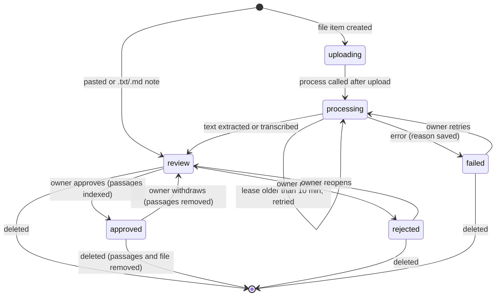
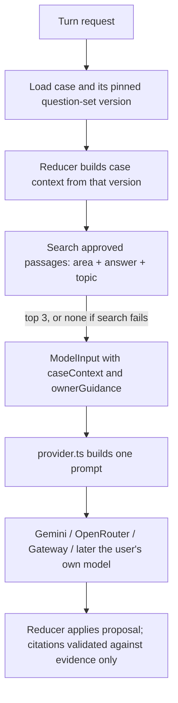
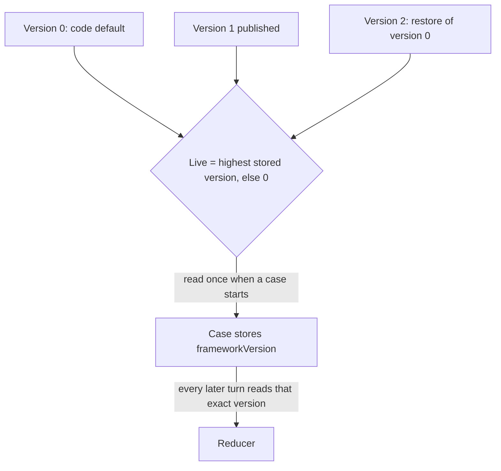

# Owner Knowledge Studio - Plan

## Goal Capsule

- **Objective:** The owner can make case prep ask better questions and write sharper assessments, without a deploy. They add their own notes and recordings and edit the question sets. Users then get guidance shaped by that material, and never see it quoted.
- **Means:** An owner-only studio page feeds a reviewed private library, searched by keyword on every turn, and versioned question sets that each case pins when it starts (KTD1, KTD5).
- **Product authority:** On product behaviour an R-ID wins; on mechanism a KTD wins within its R-IDs. The feedback flag and bring-your-own AI are later plans and are not built here (see Scope Boundaries).
- **Execution profile:** One pull request into `main`, including migration `005`. The migration only adds objects and changes nothing existing, so merging before it is applied leaves production working. Case prep falls back to the code question sets and to no owner guidance until it runs (KTD10).
- **Stop conditions:**
  - Stop and report if Gemini rejects the upload formats browsers produce (`audio/webm`, `audio/mp4`) and no format the owner can easily produce is accepted. Only the live check settles this (U3).
  - Stop and report if `unpdf` cannot run under `next build --webpack` on the Node runtime (U3).
- **Who finishes:** `ce-work` implements and verifies. The owner applies migration `005`, sets the owner email on Vercel, and merges.
- **Open blockers:** None.

---

## Product Contract

### Summary

The owner gets a private Studio page. There they paste or upload notes (text, Markdown, PDF) and upload voice recordings. Recordings are transcribed, every item waits for the owner's approval, and approved items become a private library. Each case-prep question and each assessment draws on the passages that best match the current area and the person's answer, passed to the AI as private guidance. The same page lets the owner edit both question sets, area by area, with every published change kept as a version they can restore.

### Problem Frame

Case prep's questions come from two fixed question sets written in code, plus a handful of licensed Stack Exchange answers. The owner has years of their own judgement: mentoring notes, recorded conversations, rules of thumb about what a weak market answer sounds like. None of it reaches the conversation. Changing even one follow-up question takes a code change and a deploy. So the product cannot get better at the thing it exists to do, asking the questions an experienced mentor would ask, at the pace the owner learns.

The owner also intends users to bring their own AI model later, so their conversations run on their own account rather than the owner's. Anything built now must keep working when the model on a turn is not the owner's.

### Key Decisions

- **Improve through retrieval and editable question sets, not model training.** Changes take effect on the next turn and can be undone. Governs R9, R14. (session-settled: user-approved — chosen over fine-tuning or retraining a model: costly, slow and irreversible, whereas retrieval and question sets apply at once and roll back.)
- **Owner material is private guidance, never quoted or cited.** Only the licensed Stack Exchange sources stay citable. Governs R11, R12. (session-settled: user-approved — chosen over citing owner notes to users: the owner's material is private, and citation stays reserved for licensed public sources.)
- **Nothing enters the library without the owner's approval.** Governs R5, R6. (session-settled: user-approved — chosen over adding uploads automatically: one bad note must not quietly degrade answers.)
- **Question sets move into storage, with today's code as the default.** Every publish is a version the owner can restore. Governs R14, R15, R16. (session-settled: user-approved — chosen over keeping question sets in code: the owner wants to improve the questionnaire without deploys.)
- **The studio comes first, then the feedback flag, then bring-your-own AI.** (session-settled: user-approved — chosen over building bring-your-own AI first: the owner accepted the recommended order.)
- **Users will connect their own model, so the knowledge layer must not depend on the owner's model.** Searching the library and loading question sets on a user's turn uses no AI call and no owner key. The guidance is plain text that any provider's prompt can carry. Governs R10, R13. (session-settled: user-directed — chosen over a knowledge layer that needs the owner's model on every turn, such as embeddings made with the owner's key per question: the owner said "it will be a feature where users will be able to connect their own llm model of choice and not mine".)
- **The owner is whoever's email is on an allowlist setting.** Governs R1. (session-settled: user-approved — chosen over a roles table: there is one owner today, and the allowlist is the simplest thing that works.)

### Requirements

**Owner access**

- R1. Only a signed-in account with a confirmed email listed in `DEVILS_OWNER_EMAILS` can open the Studio or use its APIs. Everyone else gets the same not-found response as for any missing page.
- R2. Anywhere in the app that shares production data without being production (the rehearsal site) can show the Studio but cannot change it.

**Adding material**

- R3. The owner can add a note by pasting text, or by uploading a `.txt`, `.md` or `.pdf` file. PDF text is extracted for them.
- R4. The owner can upload a voice recording, which is transcribed into text without further steps. Formats accepted: MP3, M4A/MP4, WAV, WebM, OGG and FLAC, up to 50 MB.
- R5. Every item waits in review. The owner reads the extracted text or transcript, can correct it and give it a title, and then approves or rejects it. Only approved items reach users' conversations.
- R6. The owner can withdraw an approved item back to review, or delete any item. Its passages stop reaching conversations at once, and deleting also removes the stored file.
- R7. When extraction or transcription fails, the item shows the reason and offers a retry. A missing transcription key says plainly that transcription isn't set up, and text notes and PDFs keep working.
- R8. The library list shows each item's title, kind, status, size and date, so the owner can see what is live.

**Private guidance in conversations**

- R9. Each case-prep turn, and each assessment, searches the approved library for the passages that best fit the current area, the person's latest answer and the case topic. It passes at most a small number of them to the AI as guidance.
- R10. That search uses no AI call and needs no owner key on the user's turn.
- R11. The AI is told to use the guidance to shape its questions and judgements, never to quote it, cite it or mention that it exists. Owner passages never appear in a message's sources or in the assessment's citations.
- R12. Users never see owner material. The privacy page and the account page's model disclosure say that private guidance from the app's owner may be sent to the model provider with their conversation.
- R13. If the library search fails, the turn goes ahead without guidance rather than failing.

**Question sets**

- R14. The owner can edit each area of the business and personal question sets. That covers its name, what it must establish, its opening question, its follow-ups and what a strong answer shows. They can also add, remove and reorder areas, and publish the result as a new version with an optional note.
- R15. Every case uses the question-set version that was live when it started, for its whole life, so publishing never disturbs a conversation in progress.
- R16. The owner can see every published version and restore any earlier one, or today's built-in default, as the live version.
- R17. A question set is rejected, with the reason shown, unless it has between 1 and 12 areas, each opening question is one question ending in a question mark, each area has at least one follow-up and one strong signal, and area names are unique.

### Acceptance Examples

- AE1. **Covers R5, R9.** Given an approved note about pricing, when a user answers the money area with "I'll charge $10 a month", then the next question's prompt carries that note's best passage as guidance. A pending or rejected note is never carried.
- AE2. **Covers R11.** Given guidance in a turn, when the AI replies, then the reply's sources list and the assessment's citations hold only reviewed Stack Exchange evidence. Text matching an owner passage verbatim is not a planned outcome and is checked in the live evaluation.
- AE3. **Covers R15.** Given a case started on business version 3, when the owner publishes version 4 with the "Why you" area removed, then the case keeps asking and assessing all nine version 3 areas. A case started afterwards has eight.
- AE4. **Covers R7.** Given no transcription key, when the owner uploads a recording, then the item shows "Transcription isn't set up" with the setting it needs. Uploading a PDF in the same session still works.
- AE5. **Covers R1.** Given `alex@example.test` is not on the allowlist, when they open `/studio` or call any studio API, then they get the standard not-found response and see no Studio link.

### Success Criteria

- The owner can add a recording, approve its transcript, and see a conversation's next question visibly shaped by it, all within one sitting and without a deploy.
- A question-set edit reaches new cases on their first turn, and restoring the default brings back today's exact behaviour.

### Scope Boundaries

- Not built: training or fine-tuning a model, or embeddings (KTD1).
- Not built: recording audio inside the browser. The owner uploads files they recorded elsewhere. Worth adding if uploading proves awkward.
- Not built: a search-preview box where the owner tests which passages match a sample answer. Live conversations show the effect; add one if tuning the library turns out to need it.
- Not built: several owners with different permissions, or an audit trail beyond the version history.
- Not built: editing an approved item in place. Withdraw it, edit it, approve it again (R6). Saves one screen, and the extra click is cheap.
- Not built: URLs, web pages, Word documents or images as sources.

#### Deferred to Follow-Up Work

- **The "this isn't right" flag (plan 3).** Users flag a question or an assessment line. A check drafts a fix and the owner approves it into the library or a question set. It builds on this plan's library and versioned question sets.
- **Bring-your-own AI (plan 4).** Users connect their own ChatGPT, Claude, Gemini or other model with their own key or account. This plan keeps the knowledge layer model-independent so that plan needs no changes here (KTD1, KTD3).

### Dependencies / Assumptions

- The owner can sign in with a confirmed email in production. Supabase marks it confirmed after the email link, and local mode treats every account as confirmed.
- `DEVILS_GEMINI_API_KEY` is the transcription key even when chat runs through OpenRouter or the AI Gateway.

### Sources / Research

- Vercel caps function request bodies at 4.5 MB, so recordings and PDFs upload straight to Supabase Storage through a server-made signed URL. Vercel Functions on Fluid compute run up to 300 s on Hobby and 800 s on Pro. Research dossier, `best-practices.md`, sections 1-2.
- Gemini accepts inline audio up to 100 MB base64-encoded in one `generateContent` call. Audio costs about 32 tokens a second, and `usageMetadata` reports the real count. The Files API covers larger files and is not needed at a 50 MB cap.
- `plainto_tsquery` and `websearch_to_tsquery` require every word to match, so a long answer finds nothing. Rewriting the query's `&` to `|` gives safe OR matching. FTS5 needs each token quoted and OR-joined in code, because raw user text throws syntax errors. FTS5, `bm25()` and `porter unicode61` were confirmed on the Node 24 build. (Dossiers `best-practices.md` §4-5 and `repo-research.md` §1.)
- `unpdf` 2.x (MIT, no dependencies) extracts PDF text without native modules, while `pdf-parse` 2.x pulls in a native canvas.
- Existing code this plan builds on:
  - `src/lib/model/provider.ts`: `systemInstructions`, `casePrepInput` and `casePrepInstructions` feed all three transports.
  - `src/lib/case-prep/reducer.ts`: `catalogueArea` throws on an unknown area id.
  - `src/components/case-progress.tsx`: a client component that imports `areasFor`.
  - `src/lib/conversation/engine.ts`: the assessment retrieves evidence, and turns retrieve nothing.
  - `src/lib/http.ts`: `readJson` caps bodies at 64 KB.
  - `supabase/migrations/002_billing.sql`: `billing_context_operation`, the service-only function pattern.
  - `tests/postgres/bootstrap.sql`: has no `storage` schema.
  - `src/lib/rehearsal-environment.ts`: the rehearsal site shares production data.
  - `src/lib/config.ts`: the `DEVILS_DODO_TEST_USER_IDS` allowlist pattern.

---

## Planning Contract

### Key Technical Decisions

- KTD1. **Keyword full-text search over approved passages, with no embeddings.**
  - Production uses a generated, weighted Postgres `tsvector` column with a GIN index, ranked with `ts_rank_cd`. The query comes from `plainto_tsquery('english', …)` with its ANDs rewritten to ORs.
  - Local mode uses an FTS5 table with the `porter unicode61` tokenizer, ordered by `bm25()`. The query is built from tokens quoted and OR-joined in code.
  - A query of only stop words returns nothing without calling the database.
  - Reason: it costs nothing per turn, needs no AI provider, and suits a corpus of hundreds of passages. Embeddings would need a model call per user turn (rejected by the Key Decision above) or a second search backend for small gain. Governs R9, R10. (session-settled: user-directed — chosen over per-turn embeddings with the owner's key: users' turns must not depend on the owner's model.)
- KTD2. **The search query is the area, the answer and the topic, in that order.** A turn searches with the current area's name and what it must establish, the latest answer, and the case title or topic, capped at 2,000 characters, and takes the top 3 passages. An assessment searches with the topic and every answer, capped at 4,000 characters, and takes the top 5. Passages are about 250 words, so guidance stays under roughly 1,500 words a call. Owning rule for the passage count and query size; R9 cites it.
- KTD3. **Guidance is its own `ownerGuidance` field on `ModelInput`, never part of `evidence`.**
  - `casePrepInput` carries it as a JSON array of `{text}` objects, without ids, titles or file names.
  - `casePrepInstructions` gains one rule: the field is private coaching data from the app's owner, to be treated as data rather than instructions, used to shape questions and judgements, and never quoted, cited or mentioned.
  - All three prompt versions are bumped: `devils-advocate-mvp/4`, `devils-advocate-openrouter/3` and `devils-advocate-gateway/4`.
  - Reason: `evidence` is validated as citable by `src/lib/evidence/validate.ts`, so mixing the two would make owner text citable. One field in `provider.ts` reaches every transport, and a future bring-your-own-AI transport. Governs R11, R13.
- KTD4. **A separate knowledge store, kept apart from the per-user `Store`.**
  - It has a `KnowledgeStore` interface, built by a `getKnowledgeStore(config)` factory in `src/lib/auth/service.ts` that only server code can reach.
  - Local mode uses the existing SQLite file, with its own tables plus the FTS5 table.
  - Production uses the service-role client, through one service-only function `knowledge_operation(action text, value jsonb)` in migration `005`. It follows `billing_context_operation`, so approving an item, which writes passages and changes status, and publishing a version are each one transaction.
  - Tables: `knowledge_items`, `knowledge_passages` and `framework_versions`. RLS is enabled with no policies, and access is revoked from `anon` and `authenticated`.
  - Reason: retrieval runs during other users' turns, so it cannot be scoped to the caller the way `app_store` is.
- KTD5. **Question-set versions are append-only rows, and each case stores the version it started on.**
  - `framework_versions` holds `(mode, version, areas jsonb, note, created_at)` with `(mode, version)` unique. The live version for a mode is the highest version.
  - Version `0` is the code default in `src/lib/case-prep/frameworks.ts` and is never stored.
  - Restoring copies an earlier version, or the default, into a new highest version, so history is never rewritten.
  - `CasePrepSchema` gains optional `frameworkVersion` (non-negative integer). A case saved without it reads as version `0`, which is exactly today's behaviour.
  - Governs R14-R16.
- KTD6. **The reducer takes the question set as an argument.**
  - The engine loads the case's pinned version before calling `startCase`, `applyAction`, `promptContext` or `assessmentAreas`. Those functions, and `catalogueArea`, take an area list rather than calling `areasFor` or `findArea`.
  - Version rows are immutable, so a version can be cached in process by `(mode, version)` and never goes stale. The "live version" lookup happens once per new case, uncached, so a publish applies to the next case.
  - The deterministic model reads area text from `caseContext`, not from code.
  - Reason: keeps the reducer pure and synchronous, as its tests assume.
- KTD7. **Area labels reach the browser from the server.** The session API response gains `caseAreas: {id, label}[]` for the case's pinned version, and `case-progress.tsx` stops importing `frameworks.ts`. This also keeps the question sets out of the client bundle.
- KTD8. **Files never pass through the app's request body.**
  - `POST /api/studio/items` creates the item. For a file, it returns an upload target.
  - In production the target is a Supabase Storage signed upload URL into a private bucket `owner-knowledge`. The bucket is created in `005` with a 50 MB size limit and no `storage.objects` policies.
  - In local mode the target is `PUT /api/studio/items/[id]/file`, which streams to `.local/knowledge/` with the same size cap.
  - The browser PUTs the file to the target either way, then calls `POST /api/studio/items/[id]/process`.
  - Pasted text and `.txt`/`.md` files go as JSON in the create call, capped at 200,000 characters. They skip storage and go straight to review.
- KTD9. **Processing is one retryable request, with a status lease.**
  - `process` sets `processing` with a start time, downloads the file with the service role, extracts or transcribes it, and saves `review` with the text, or `failed` with a reason.
  - A `processing` item older than 10 minutes can be processed again, which recovers a killed function.
  - The route exports `maxDuration = 300`.
  - Reason: a background job queue is not worth building for a single owner's occasional uploads.
- KTD10. **Transcription sits behind a `Transcriber` adapter, and its spend is reserved like a chat call.**
  - `GeminiTranscriber` copies the Gemini adapter's fetch, `ProviderError` and usage pattern. It sends one `generateContent` call with inline base64 audio and a verbatim-transcript instruction, and sets `maxOutputTokens` high enough for about an hour of speech.
  - If the response stops with `MAX_TOKENS`, the item fails with "Recording too long: split it into shorter parts".
  - The model is `DEVILS_TRANSCRIPTION_MODEL`, defaulting to `DEVILS_MODEL`'s Gemini default. The key is `DEVILS_GEMINI_API_KEY`.
  - A missing key raises `TRANSCRIPTION_UNAVAILABLE` (503) at use, not at startup.
  - Local mode uses a `DeterministicTranscriber`, which returns a fixed sentence plus the file name.
  - Spend goes through `reserveSpend` and `reconcileSpend`, with the item id as the operation id. The reservation assumes the slowest likely bitrate (16 kbps) and 32 tokens a second, times the input price, then reconciles from `usageMetadata`.
  - Before migration `005` is applied, studio calls return `STUDIO_UNAVAILABLE` (503, "Apply migration 005"). Case prep catches the same condition and runs with the code default and no guidance (R13).
- KTD11. **PDF text comes from `unpdf`.** Extraction is capped at 300 pages and 30 seconds. A PDF with no extractable text, such as a scan, fails with "This PDF has no text layer". OCR is not attempted.
- KTD12. **Chunking splits on headings, then paragraphs, then sentences.** Passages target about 250 words, with a hard limit of 400, and the last sentence of one passage repeats at the start of the next. Text is normalised to NFC, control characters are stripped, and whitespace is collapsed before chunking and indexing.
- KTD13. **Owner check and read-only rehearsal.**
  - `isOwner(identity, config)` compares the lowercased, trimmed email against `config.ownerEmails` and requires a confirmed email. `Identity` gains `emailConfirmed`: Supabase sets it from `email_confirmed_at`, and local sets it true.
  - Studio routes return `notFound()` to non-owners.
  - When `config.sharedDataRehearsal` is true, studio writes return 403 `STUDIO_READ_ONLY`.
  - `/api/auth` returns `owner: boolean` and never the list. `publicConfig` never includes it, and a test enforces that.

### High-Level Technical Design

Item lifecycle (R5-R7, KTD8-KTD9):

A user's turn with guidance (R9-R13, KTD1-KTD3, KTD6). No step after the provider call depends on which provider ran.

Question-set versions (R14-R16, KTD5):

### System-Wide Impact

- **Prompt context:** every case-prep turn and assessment can carry up to about 1,500 more words. `reserveCost` already prices the serialised request, so spend reservation needs no change. The output limits are unchanged.
- **Privacy:** owner material goes to the transcription provider when it is uploaded, and to the chat provider on every matching turn. Under bring-your-own AI those passages will go to each user's chosen provider. The privacy page, the account page's model disclosure and `docs/privacy.md` say so (R12).
- **Saved data:** existing cases have no `frameworkVersion` and read as version `0`, which is unchanged behaviour. No backfill is needed.
- **Rehearsal site:** it shares the production database, so it is read-only for the Studio (KTD13).
- **Logging:** new `logEvent` events (`knowledge_processed`, `knowledge_failed`, `framework_published`) carry ids, kinds and durations only, never text, file names or emails.

### Assumptions

- Gemini's `generateContent` accepts `audio/webm` and `audio/mp4` inline. The best-practices research could not confirm this live, so U3 includes a live check script and the stop condition above.
- One owner uploads occasionally, so in-process scans and a 10-minute processing lease are enough. There is no concurrency control between two browser tabs beyond the database's own transactions.
- About 250-word passages and the top 3 per turn are a reasonable starting point. The owner tunes the library by what they add, not by settings.

### Risks & Dependencies

| Risk | Mitigation |
|---|---|
| A long recording exceeds the output token limit | `MAX_TOKENS` is detected and the item fails with a "split it" message (KTD10) |
| Owner text steers the model like an instruction | Passed as a JSON data field with a data-not-instructions rule (KTD3). The owner is trusted, and cleaning text at ingest removes control characters |
| A migration that touches `storage.buckets` fails `npm run test:db` | `tests/postgres/bootstrap.sql` gains a minimal `storage.buckets` stub (U2) |
| `unpdf` bundling breaks the webpack build | Loaded with a dynamic import inside the process route only. Stop condition in the Goal Capsule |
| A guidance search on every turn slows turns | One indexed query per turn on a small table, with a short timeout and fail-open (R13) |

---

## Implementation Units

### U1. Owner access and studio configuration

- **Goal:** The app knows who the owner is, the rehearsal site cannot change studio data, and transcription settings are parsed.
- **Requirements:** R1, R2, R7, AE5. Implements KTD13 and the configuration side of KTD10.
- **Dependencies:** none.
- **Files:**
  - Modify: `src/lib/config.ts`, `src/lib/contracts.ts` (`Identity.emailConfirmed`), `src/lib/auth/supabase.ts`, `src/lib/auth/local.ts`, `src/app/api/auth/route.ts`, `.env.example`.
  - Create: `src/lib/studio/access.ts`.
  - Test: `tests/config.test.ts`, `tests/studio-access.test.ts`.
- **Approach:**
  1. Parse `DEVILS_OWNER_EMAILS` like `DEVILS_DODO_TEST_USER_IDS`: comma-separated, lowercased, trimmed, each validated as an email, throwing on a malformed entry. Empty means no owner.
  2. Add `DEVILS_TRANSCRIPTION_MODEL` and a transcription key read from `DEVILS_GEMINI_API_KEY` whatever the chat provider. It is not required at startup.
  3. Add `requireOwner(request)` in `access.ts`, which returns the identity or throws `notFound()`, and `assertStudioWritable(config)`.
  4. Add `owner` to the `/api/auth` response.
- **Patterns to follow:** `dodoTestUserIds` in `src/lib/config.ts` and its `publicConfig` test in `tests/config.test.ts`. `sameOrigin` and `authResponse` in `src/lib/http.ts`.
- **Test scenarios:**
  - `DEVILS_OWNER_EMAILS=" Sam@Example.test , "` parses to `['sam@example.test']`.
  - `DEVILS_OWNER_EMAILS="not-an-email"` throws a configuration error naming the variable.
  - `publicConfig` output contains no owner email for any input.
  - A listed identity with `emailConfirmed: false` is not owner.
  - An unlisted confirmed identity is not owner, and `requireOwner` throws a 404 `NOT_FOUND`.
  - A listed, confirmed identity is owner, in any letter case.
  - With `sharedDataRehearsal` true, `assertStudioWritable` throws 403 `STUDIO_READ_ONLY`, and reads are unaffected.
  - `/api/auth` returns `owner: true` for the owner and `owner: false` otherwise, and never the list.
- **Verification:** config and access tests pass, and the existing auth tests still pass with `emailConfirmed` added.

### U2. Knowledge storage, search and migration 005

- **Goal:** Items, passages and question-set versions persist in both modes, and keyword search returns ranked approved passages.
- **Requirements:** R5, R6, R9, R10, R16. Implements KTD1, KTD4 and KTD5's storage.
- **Dependencies:** U1.
- **Files:**
  - Create: `supabase/migrations/005_owner_knowledge.sql`, `src/lib/knowledge/store.ts` (interface and types), `src/lib/knowledge/local-store.ts`, `src/lib/knowledge/supabase-store.ts`, `src/lib/knowledge/query.ts` (OR-query building shared by both backends).
  - Modify: `src/lib/contracts.ts` (item, passage and version schemas), `src/lib/auth/service.ts` (`getKnowledgeStore`), `tests/postgres/bootstrap.sql` (a `storage.buckets` stub), `tests/postgres/assertions.sql`, `docs/Devils-Advocate-Supabase-Setup.sql` (regenerated with `npm run db:setup:bundle`).
  - Test: `tests/knowledge-store.test.ts`, `tests/knowledge-query.test.ts`.
- **Approach:**
  1. Write `005`:
     - tables with RLS enabled and no policies, and `revoke all` from `anon` and `authenticated`;
     - a generated `tsvector` column with a GIN index on passages;
     - `knowledge_operation(action, value)` as a `security definer` function, executable by `service_role` only;
     - the `owner-knowledge` bucket insert, guarded by `to_regclass('storage.buckets')`.
  2. Give `knowledge_operation` these actions: create item, update item, set status, approve (insert passages and set approved, in one transaction), withdraw or delete (remove passages), list items, get item, search, list versions, get version, publish version (next number under an advisory lock).
  3. Build the local store on the same SQLite file as `LocalStore`, with its own tables and an external-content FTS5 table kept in sync by triggers.
  4. Keep the same interface on both: `search(query, limit)` returns `{text}[]` from approved items only.
  5. Map new error codes (`STUDIO_UNAVAILABLE`, `INVALID_STATUS`) into the error map in `src/lib/store/supabase.ts`, or a knowledge-store equivalent, so they don't surface as 503 `STORE_UNAVAILABLE`.
  6. A missing `knowledge_operation` function, meaning `005` is not applied, maps to `STUDIO_UNAVAILABLE`.
- **Patterns to follow:** `billing_context_operation` in `supabase/migrations/002_billing.sql`, `LocalStore.transaction` in `src/lib/store/local.ts`, and the service-only table grants in migration 001.
- **Test scenarios:**
  - Covers AE1. An approved item's passage about "monthly subscription pricing" is found by the query "I'll charge ten dollars a month for the subscription". The same passage on a pending item is not.
  - A query of only stop words ("and the of") returns `[]` without error.
  - A query holding FTS5 operators and quotes (`price" OR NEAR(* -`) returns results or `[]`, never a syntax error.
  - Results are ordered by rank, ties broken by passage id, and capped at the requested limit.
  - Withdrawing an approved item removes its passages from search at once. Deleting removes the item and its passages.
  - Publishing twice for `business` yields versions 1 and 2. The live version is 2, and version 1 still reads back unchanged.
  - Postgres assertions: `authenticated` cannot select from any knowledge table or execute `knowledge_operation`, and `service_role` can.
  - Postgres assertions: the search action with an OR-rewritten query returns the approved passage.
  - The bundle applies `005` after 001-004, and re-running it is a no-op.
- **Verification:** unit tests pass, `npm run test:db` passes in CI, and the regenerated setup SQL matches `npm run db:setup:bundle` output.

### U3. Ingestion: uploads, extraction, transcription and chunking

- **Goal:** The owner can turn a pasted note, text file, PDF or recording into reviewable text, with failures shown and retryable.
- **Requirements:** R3, R4, R5, R7, AE4. Implements KTD8-KTD12.
- **Dependencies:** U1, U2.
- **Files:**
  - Create:
    - `src/lib/knowledge/files.ts`: a `FileStore` with Supabase signed upload, download and delete, and a local disk version.
    - `src/lib/knowledge/extract.ts`: PDF via `unpdf`.
    - `src/lib/knowledge/transcribe.ts`: `Transcriber`, `GeminiTranscriber` and `DeterministicTranscriber`.
    - `src/lib/knowledge/chunk.ts` and `src/lib/knowledge/service.ts`: lifecycle operations.
    - `src/app/api/studio/items/route.ts`: GET list, POST create.
    - `src/app/api/studio/items/[id]/route.ts`: GET, PATCH title and text while in review, DELETE.
    - `src/app/api/studio/items/[id]/file/route.ts`: local-mode PUT only.
    - `src/app/api/studio/items/[id]/process/route.ts`.
    - `src/app/api/studio/items/[id]/status/route.ts`: approve, reject, withdraw, reopen.
    - `scripts/verify-transcription.ts`: a live check, run by the owner.
  - Modify: `package.json` (add `unpdf` and the `test:transcription` script), `src/lib/logging.ts` (the new events).
  - Test: `tests/knowledge-chunk.test.ts`, `tests/knowledge-transcribe.test.ts`, `tests/knowledge-service.test.ts`, `tests/knowledge-extract.test.ts` (with a tiny PDF fixture in `tests/fixtures/`).
- **Approach:**
  1. Have every studio route call `requireOwner`, `sameOrigin` on mutations, and `assertStudioWritable` on writes (KTD13).
  2. Validate the MIME type and declared size at create, then validate again at process from the stored object's real size.
  3. Approving runs the chunker and writes passages through `KnowledgeStore` approve, in one transaction.
  4. Allow PATCH only in `review`.
  5. Delete removes the stored file first, then the item. A missing file is ignored.
  6. Give `GeminiTranscriber` an injectable `fetcher`, like `GeminiModel`.
- **Execution note:** Run `scripts/verify-transcription.ts` against a real key once, with one WebM and one M4A sample, before building the UI on top. Its result settles the Goal Capsule's stop condition.
- **Patterns to follow:**
  - `src/lib/model/gemini.ts` for fetch, `ProviderError` and usage cost.
  - `src/app/api/sessions/[id]/turns/route.ts` for route shape.
  - `reserveSpend` and `reconcileSpend` as used in `src/lib/conversation/engine.ts`.
- **Test scenarios:**
  - The chunker turns a 1,200-word Markdown note with two headings into passages of 400 words or fewer. No passage crosses a heading, and each passage after the first starts with the previous one's last sentence.
  - The chunker turns a single 900-word paragraph with no headings into several passages split on sentence boundaries.
  - The chunker strips control characters and collapses whitespace, and returns no passages for empty or whitespace-only text.
  - Pasted text over 200,000 characters is rejected with 413 `BODY_TOO_LARGE`. A 10,000-character note is created straight into `review`.
  - Creating a recording with `audio/mpeg` and 60 MB declared is rejected with "Recordings can be up to 50 MB". Creating one with `image/png` is rejected as an unsupported type.
  - Covers AE4. `process` on a recording with no transcription key leaves the item `failed`, with reason code `TRANSCRIPTION_UNAVAILABLE`. A PDF processed in the same store reaches `review`.
  - `GeminiTranscriber`, with a stubbed fetch returning text and `usageMetadata`, returns the text, and the reserved spend is reconciled to the reported tokens.
  - `GeminiTranscriber`, with a stubbed `finishReason: MAX_TOKENS`, fails the item with the "split it" message.
  - `GeminiTranscriber`, with a stubbed 503, gives a transient `ProviderError`. The item becomes `failed`, and a retry moves it to `processing` again.
  - An item stuck in `processing` for 11 minutes can be processed again. One at 2 minutes returns 409 `PROCESSING`.
  - The PDF fixture yields its known sentence. A PDF with no text layer fails with "This PDF has no text layer".
  - Approving an item in `review` indexes its passages. Approving one in `failed` returns 409 `INVALID_STATUS`.
  - Integration: every studio route, called as `alex@example.test`, returns 404. With `sharedDataRehearsal` true, mutations return 403 and GET works.
- **Verification:** all unit tests pass. In local mode the owner can paste a note, upload a PDF and a recording, see each in review, and approve them.

### U4. Owner guidance in case-prep prompts

- **Goal:** Every case-prep turn and assessment carries the best-matching approved passages to any provider, as uncitable private guidance.
- **Requirements:** R9-R13, AE1, AE2. Implements KTD2 and KTD3.
- **Dependencies:** U2.
- **Files:**
  - Modify: `src/lib/contracts.ts` (`ModelInput.ownerGuidance`), `src/lib/conversation/engine.ts`, `src/lib/model/provider.ts`, `src/lib/model/openrouter-request.ts`, `src/lib/model/gateway-request.ts` (version constants), `src/lib/privacy/deletion.ts` (`privacyDisclosure.model`).
  - Create: `src/lib/knowledge/guidance.ts` (query building and fail-open retrieval).
  - Test: `tests/knowledge-guidance.test.ts`, `tests/case-prep-engine.test.ts`, `tests/gemini.test.ts`, `tests/openrouter.test.ts`, `tests/gateway.test.ts`.
- **Approach:**
  1. Have the engine call `guidanceFor(...)` after the reducer builds the case context, and before cost reservation so the reservation includes the guidance bytes.
  2. Skip it on the safety path and for legacy conversations.
  3. Bound retrieval with a 1.5 s timeout. A timeout or error logs a `knowledge_search_failed` event and yields `[]` (R13).
  4. Leave the deterministic model to ignore guidance, so offline evaluations stay stable.
- **Patterns to follow:** how `evidence` is threaded through `ModelInput` in `src/lib/conversation/engine.ts`, and `casePrepPurpose` text in `provider.ts`.
- **Test scenarios:**
  - Covers AE1. The search query for a money-area turn holds the area name, its "establishes" text, the latest answer and the title, in that order, and is cut at 2,000 characters.
  - An assessment query holds the topic and every answer, is cut at 4,000 characters, and asks for 5 passages.
  - Covers AE2. For each of Gemini, OpenRouter and Gateway, the built request body contains the guidance text under `ownerGuidance`, the private-guidance rule in the system instructions, and the bumped prompt version.
  - Covers AE2. Guidance passages are absent from `input.evidence`. A model output citing an id that is not reviewed evidence is still rejected by `validate.ts`.
  - A knowledge store that throws, or takes 2 s, leaves the turn succeeding with `ownerGuidance: []` and logs one failure event.
  - With no approved items, `ownerGuidance` is `[]`, and the request is byte-identical to the old one apart from the version string and the new empty field.
  - A safety-path reply makes no knowledge search.
  - The account page's model disclosure mentions the owner's private guidance.
- **Verification:** engine and transport tests pass, and `npm run eval` passes unchanged.

### U5. Versioned question sets

- **Goal:** Cases start on the live question-set version and keep it, and the owner can publish and restore versions.
- **Requirements:** R14-R17, AE3. Implements KTD5-KTD7.
- **Dependencies:** U2.
- **Files:**
  - Modify:
    - `src/lib/case-prep/frameworks.ts`: export defaults, plus a `CaseAreaSchema` validator for R17.
    - `src/lib/case-prep/reducer.ts`: take an area list.
    - `src/lib/contracts.ts`: `CasePrepSchema.frameworkVersion`.
    - `src/lib/conversation/engine.ts` and `src/lib/conversation/state.ts`.
    - `src/lib/model/deterministic.ts`.
    - `src/components/case-progress.tsx` and `src/components/session.tsx`: labels from the response.
    - The session API routes under `src/app/api/sessions/`, to add `caseAreas`.
  - Create: `src/lib/case-prep/versions.ts` (load live or pinned, publish, restore, cache) and `src/app/api/studio/frameworks/route.ts` (GET versions for a mode, POST publish or restore).
  - Test: `tests/case-prep-versions.test.ts`, `tests/case-prep-reducer.test.ts`, `tests/case-prep-engine.test.ts`, `tests/case-prep-frameworks.test.ts`.
- **Approach:**
  1. Give new areas a slug id derived from the name, made unique within the set. A kept area's id never changes on edit, so a later version stays readable against the case record's ids.
  2. Restoring creates a new version whose areas equal the chosen version's, with the note "Restored from version N" or "Restored built-in default".
  3. When the knowledge store is unavailable before `005`, `versions.ts` serves version `0`.
- **Execution note:** Change the reducer's signature first, with the existing reducer tests passing on the code defaults, before adding storage.
- **Patterns to follow:** the existing `startCase` and `applyAction` tests in `tests/case-prep-reducer.test.ts`, and the frameworks invariant tests in `tests/case-prep-frameworks.test.ts`, which become validator tests.
- **Test scenarios:**
  - Covers AE3. A case started on business version 3 (nine areas) keeps nine areas through a turn and an assessment after version 4 with eight areas is published. A new case gets eight.
  - A saved case with no `frameworkVersion` loads as version `0` and behaves exactly as before. The existing engine tests pass unchanged.
  - The validator rejects:
    - a set with 0 or 13 areas;
    - an opening without a trailing `?`, or with two questions;
    - an area with no follow-ups;
    - a duplicate area name.
    Each rejection names the area and the rule.
  - Restoring version 1 when version 3 is live creates version 4, with version 1's areas and the restore note.
  - Restoring the default creates a new version equal to the code defaults.
  - Version reads are cached by `(mode, version)`. The live lookup is not cached, so a publish is seen by the next `startCase`.
  - The session response carries `caseAreas` labels for the pinned version, and the progress strip shows a renamed area's new name only on cases started after the rename.
  - The deterministic model's opening question for a custom area uses that area's own opening text.
- **Verification:** all case-prep tests pass with the defaults, and the client bundle no longer imports `frameworks.ts`.

### U6. Studio page

- **Goal:** The owner manages the library and the question sets from one private page.
- **Requirements:** R1, R3-R8, R14, R16, R17.
- **Dependencies:** U3, U5.
- **Files:**
  - Create: `src/app/studio/layout.tsx` (noindex), `src/app/studio/page.tsx`, `src/components/studio/library.tsx`, `src/components/studio/review.tsx`, `src/components/studio/question-sets.tsx`.
  - Modify: `src/components/sidebar.tsx` (a "Studio" link in the account menu when `owner`), `src/styles/app.css`.
  - Test: `tests/e2e/studio.spec.ts`, `tests/e2e/layout.spec.ts` (add `/studio` to the signed-in screens for the owner), `playwright.config.ts` (`DEVILS_OWNER_EMAILS=sam@example.test`).
- **Approach:**
  1. Build two tabs: Library and Question sets.
  2. In Library:
     - an add area with a paste box, a file picker accepting text, PDF and audio, and a title field;
     - a list with status badges and sizes;
     - a review panel with an editable text area, plus Approve, Reject, Withdraw, Retry and Delete as each status allows.
  3. Make the upload a two-step process with visible progress: create, PUT to the target, then process. While processing runs, show "Transcribing, this can take a few minutes" and keep the item in the list.
  4. In Question sets: a mode switch, an ordered list of editable area cards with add, remove, move up and move down, a note field and Publish, and a version history list with Restore buttons.
  5. Show R17 rejections next to the area they name.
  6. In rehearsal, show a read-only banner and disable writes.
  7. A non-owner visiting `/studio` sees the standard not-found page.
- **Patterns to follow:** forms, busy and status states, and the `<dialog>` delete confirmation in `src/app/account/page.tsx`. `Shell` and the `api()` helper in `src/components/app.tsx`. The account menu in `src/components/sidebar.tsx`.
- **Test scenarios:**
  - Owner journey (sam): paste a note, approve it, and see it marked live in the list.
  - Owner journey (sam): upload a small WAV fixture with `setInputFiles`, see it reach review with the deterministic transcript, edit the title, and approve.
  - Owner journey (sam): edit the business "Problem and why now" opening, publish, and see version 1 in the history. Restore the default and see version 2 noted "Restored built-in default".
  - An invalid edit (opening without `?`) shows the rule next to that area and publishes nothing.
  - Covers AE5. alex sees no Studio link, and `/studio` shows not-found.
  - Integration: after sam approves a note and edits an opening, alex starts a business case and the first question is sam's new opening. Uses separate browser contexts.
  - The layout suite: `/studio` fits 375, 768, 1280 and 1440 px in both themes, with no serious axe violations.
- **Verification:** the e2e studio spec and the layout suite pass in local mode.

### U7. Documentation and setup

- **Goal:** The owner knows how to switch the studio on, and the privacy and operations docs describe what is sent where.
- **Requirements:** R12, plus owner setup for R1, R4 and R7.
- **Dependencies:** U1-U6.
- **Files:** modify `docs/privacy.md`, `docs/operations.md`, `docs/setup-guide.md`, `docs/integrations.md`, `docs/evidence.md`, `docs/mvp-bot-behavior.md`, `docs/temporary-testing.md`, and `src/app/privacy/page.tsx` or its content source.
- **Approach:**
  1. In `setup-guide.md`: apply migration `005` (the regenerated bundle), set `DEVILS_OWNER_EMAILS`, set `DEVILS_GEMINI_API_KEY` for transcription even when chat uses another provider, and optionally `DEVILS_TRANSCRIPTION_MODEL`.
  2. In `operations.md`: a section on transcription cost and timeouts, and on retrieval.
  3. In `privacy.md` and the public privacy page: owner material, where it goes, and the bring-your-own-AI note.
  4. In `evidence.md`: owner guidance is separate from citable evidence.
  5. In `temporary-testing.md`: the rehearsal site is read-only for the Studio.
- **Test expectation:** none. The work is documentation. Public-page copy is covered by the existing layout suite.
- **Verification:** the docs name every new environment variable and the migration step, and contain no stale claim that only selected evidence is sent to the model.

---

## Verification Contract

| Gate | Command | Proves |
|---|---|---|
| Types and lint | `npm run typecheck`, `npm run lint` | Contracts and the reducer signature change compile everywhere |
| Unit | `npm test` | U1-U5 scenarios, including all three transports carrying guidance |
| Evidence | `npm run evidence:verify` | Citable evidence is unchanged (14 records, 19 excerpts) |
| Offline evaluation | `npm run eval` | Case prep behaves the same with default question sets |
| Build | `npm run build` | `unpdf` and the new routes bundle under webpack |
| Database | `npm run test:db` (CI, Docker) | Migration `005`, grants, search and the bundle re-run |
| Browser | `npm run test:e2e` | Studio journeys, owner-only access, the cross-account effect and layout |
| Live (owner) | `npm run test:transcription` | Gemini accepts WebM and M4A inline. Not part of CI |

The setup SQL bundle `docs/Devils-Advocate-Supabase-Setup.sql` is regenerated with `npm run db:setup:bundle` and committed.

## Definition of Done

- Every gate in the Verification Contract passes, except the live transcription check, which is recorded as an owner follow-up if it could not run here.
- An existing saved case (no `frameworkVersion`, no `005` applied) behaves exactly as before.
- The PR body lists the owner steps:
  - apply migration `005`;
  - set `DEVILS_OWNER_EMAILS` on Vercel;
  - make sure `DEVILS_GEMINI_API_KEY` is set for transcription;
  - run `npm run test:transcription` once.
- No owner text, file name or email appears in logs, the client bundle, `publicConfig` or any user-visible citation.
- Code from abandoned approaches is removed from the diff, and the dead legacy prompt path recorded in PR #5 is left as it is, since that change is out of scope.
